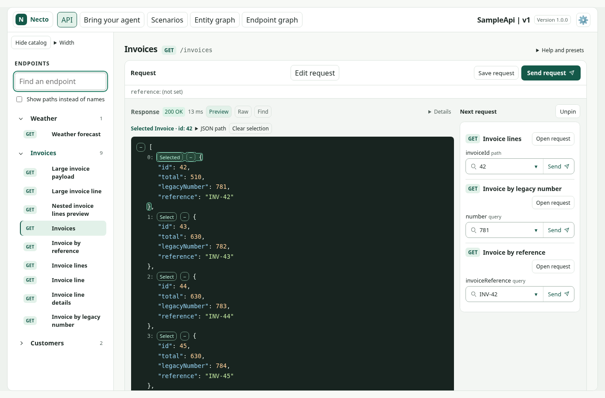

# Necto

**OpenAPI UI with a backbone.**

## Follow the data. Test the whole flow.

Select an object in an API response, carry its values into your next request,
and save the journey to run it again. Built for developers and QA working with
ASP.NET Core APIs.

- **Less copying IDs:** use selected response values in related requests.
- **Repeatable workflows:** replay saved chains with values from fresh responses.
- **Room for the response:** search large JSON across local Preview pages.
- **Connected context:** explore entity and endpoint graphs, reuse presets,
  connect external APIs, or bring your own MCP-capable agent.

**[Product website](https://nilphilus.github.io/necto/)** ·
[Live demo](https://nilphilus.github.io/necto/demo/) ·
[Setup and technical guide](https://nilphilus.github.io/necto/technical.html) ·
[Source code](https://github.com/nilphilus/necto) ·
[Local website preview](docs/landing-page/README.md#preview)

**Why Necto?** From Latin [*nectō*](https://cld.bbaw.de/lemma/lat/necto),
“I bind” or “I connect”: responses, values, and your next request.

## OpenAPI UI

Call `app.UseNectoUI()` alongside `app.MapOpenApi()` to serve the Vue UI at
`/necto/`. See the [Necto UI guide](Necto.UI/README.md) for configuration and
frontend development.

Both samples expose Necto UI and Scalar in Development. Each UI reads the same
OpenAPI document at `/openapi/v1.json` on its sample API.

| Run from the repository root | Necto UI | Scalar UI |
| --- | --- | --- |
| `dotnet run --project SampleApi` | [Necto](http://localhost:5000/necto/) | [Scalar](http://localhost:5000/scalar/) |
| `dotnet run --project SampleApi.FastEndpoints` | [Necto](http://localhost:5001/necto/) | [Scalar](http://localhost:5001/scalar/) |

## FastEndpoints sample

This sample models property billing. Every business operation requires the
`X-Tenant` header. Create two presets in **Settings → Presets** with that field,
using the values `acme` and `northstar`. The header selects the demo dataset.
Drafts are stored in memory until the API restarts.

1. Open **List buildings**, activate the Acme preset, send the request, and
   select **Browarna 12**. Its response includes the current owner.
2. Open the related **List invoices** request and send it with the selected
   building ID. The list includes invoices issued to previous owners.
3. Select the October invoice and follow **Get invoice details**. Each line
   describes billing for one asset. Select a line to open that asset's details.

Save the chain at step 3 as **Building billing history**. Run it with each
preset to compare the results. Both tenants have building 101 and invoice 501
with different owners and amounts. Acme's issued invoice 502 returns 404
under Northstar.

To try writes, run **Create a draft invoice for a building** with the example
body, then open the related **Add an asset to a draft invoice** request. Necto
fills the newly created invoice ID. Send the example body and follow **Get
invoice details** to see both lines and the total of 375 PLN.

The [HTTP examples](SampleApi.FastEndpoints/SampleApi.FastEndpoints.http)
include both flows. For a longer list of suggestions, use invoice 42 in
SampleApi, which has 12 lines.

## Large payload experiment

Necto provides local Preview pagination.
Run SampleApi and use `GET /invoices/large-payload?count=100000&noteSize=1024`
for a single response above 100 MB. Preview pages contain 25 entries and retain
absolute indices for selecting objects; changing pages does not call the API.
See the [UI guide](Necto.UI/README.md#large-responses) for limits and measurements.

**Search entire response** finds keys and values across every Preview page,
opens the matching field and lets you select its mapped object for related
requests. Search runs in a background worker, with paginated results and no extra
API calls. See [response search](Necto.UI/README.md#search-an-entire-response).

## Saved request scenarios

Save a request chain from the **Scenarios** panel and run it again with values
from fresh responses. Selections keep their JSON paths, so a chosen line item's
new ID flows into the next request. Review and edit steps, inspect run results,
or stop a running scenario. Scenarios are stored in your browser; current request
presets and external API connections apply when replaying. See the
[scenario guide](Necto.UI/README.md#saved-scenarios).

For parallel workflows, use **Scenarios → Scenario Builder**: name steps, connect any endpoints, combine response values, generate data with Faker, and pause selected requests for human input. [Scenario Builder guide](docs/scenario-builder/README.md).

## Authentication

Use **Authorize** to access protected APIs and protected OpenAPI documents. The
button is available even when the document returns 401. Necto supports Bearer/JWT,
Basic, API keys, existing browser sessions and OAuth2/OIDC Authorization Code with
PKCE, scoped to each API and approved origins. Credentials stay in tab memory.
See [authentication setup](docs/authentication/README.md).

## Bring your agent

Write a prompt in Necto and let your own MCP-capable agent discover endpoints,
types and request relationships, then report its progress and result. Your agent
uses its own model, HTTP tools and credentials. The opt-in MCP bridge connects
the workspace to your agent without a model API key in Necto. See the
[setup and workflow](docs/bring-your-agent/README.md).

## External API connections

Configure additional OpenAPI documents and Necto mappings in **Settings → External
APIs**, then turn on **Show external APIs** in the same section. Services retain their
own request URLs and operation identities. Explicit `source.apiId` / `target.apiId`
selectors allow response values to flow between configured services. See the
[external API guide](Necto.UI/README.md#external-apis) for configuration and CORS.

## XML preview

Inspect XML responses or open XML stored in a JSON string without leaving the response. Preview colors syntax, collapses nested elements and pages large collections; Raw keeps the original response text. [Examples and limits](docs/xml-preview/README.md).

## Endpoint mappings

Necto generates suggestions for reusing response values in other API requests. The
NuGet package includes a Roslyn source generator. `app.UseNectoUI()` automatically
exposes the application’s generated suggestions at `/necto/endpoint-mappings`.
For manual configuration, use `app.MapNectoEndpointMappings()` alongside
`app.MapNectoUI()`; both return builders for endpoint metadata. Register custom
mappings before `UseNectoUI()`, or pass `endpointMappingsPath` to manage the route yourself.
Necto UI discovers a single registered mappings route. For a custom JSON endpoint
or multiple registered mappings routes, pass the desired path as
`endpointMappingsPath` to `UseNectoUI` or `MapNectoUI`.

Each mapping identifies a source and a target by their OpenAPI `operationId`.
`source.eachItem` applies the selector to each element of a response array.
`source.property` is a JSON property name, with `null` selecting the entire
response or array item. `target.location` and `target.name` identify the request
field. For `location: "parameter"`, resolve the location in OpenAPI. For
`location: "body"`, a null name selects the entire JSON body.

- `type` matches the same dedicated CLR identifier type, such as `CustomerId`.
- `name` matches supported scalar fields of the same CLR type by field name
  or by the response type name followed by the field name, ignoring case.
  For example, `Invoice.Reference` matches `reference` and `invoiceReference`.
  The conventional match for `Invoice.Id` is `invoiceId`.
- `attribute` uses a logical key from `[EndpointValue("LegacyInvoice")]`.
  Use the same key on both sides, or use the conventional identifier name as the
  key on one side. The CLR types must still match.

A primitive match can include `suggestedIdentifierType` with a name for a
dedicated type. The UI should resolve the operation IDs and fields against its
active OpenAPI document before offering the suggestions.

For Minimal APIs, use a constant `.WithName(...)` in the same fluent chain.
For FastEndpoints, the generator reads the request and response DTOs declared by
endpoint classes in the project, including through intermediate base classes.
At runtime, it uses the names of registered FastEndpoints routes as operation
IDs. Call `app.UseNectoUI()` after `app.UseFastEndpoints()` and point Necto at
the OpenAPI document for those routes.

`app.UseNectoUI()` enables C# type names in the entity graph for FastEndpoints
with `FastEndpoints.OpenApi` and for ASP.NET Core `AddOpenApi` documents.
Necto uses those names for labels and OpenAPI schema keys for references.

Mapping suggestions support nested response objects and arrays, the default web
JSON naming policy, and `JsonPropertyName`. Minimal APIs support explicit
`[FromBody]` models. FastEndpoints supports top-level JSON input fields and
common route, query, and header bindings. Recursive response types stop at the
first repeated type on a branch, with a limit of 16 path segments. Custom JSON
converters are opaque to the generator.

For nested response fields, `source.objectPath` describes the containing object:
string segments are exact JSON property names and `null` segments select each
array item. For example, `{"objectPath":["invoice-lines",null],"property":"lineId"}`
selects line IDs inside an envelope. When `objectPath` is present it takes
precedence over `eachItem`; when absent, the original root selectors still apply.
The UI uses mappings resolved against OpenAPI to mark selectable objects, without
adding metadata to the API's business responses or requiring another attribute. Use `SampleApi/SampleApi.http` to try all
three match rules.

## API workbench

Send forms and files, inspect HTTP responses, copy request code, choose API servers and verify scenarios without giving up response space. [Workbench guide and CI runner](docs/api-workbench/README.md).

### Create scenarios with your agent

Install the [Necto scenario authoring skill](skills/README.md) in your API project. Your agent can use source code, OpenAPI and Necto mappings to prepare importable Scenario Builder files, including parallel steps and response bindings, without executing the API.

Scenario Builder also supports [isolated expressions](docs/scenario-expressions/README.md) to calculate field values from selected earlier responses or shared variables, using a bounded JavaScript subset without host access.

Use [Pick random](docs/scenario-random/README.md) to select an array item from a previous response, or share one selection across several fields through a scenario variable.

Troubleshooting: [ambiguous generated OpenAPI documentation helpers](docs/troubleshooting/generated-source-collisions.md), including safe XML generator output configuration.
