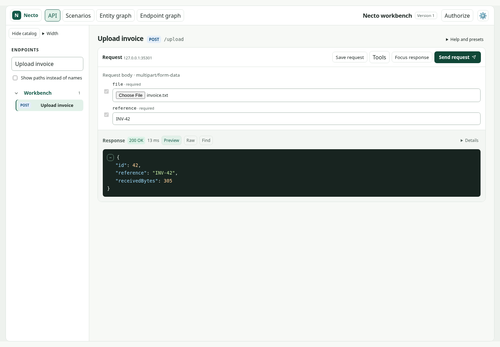
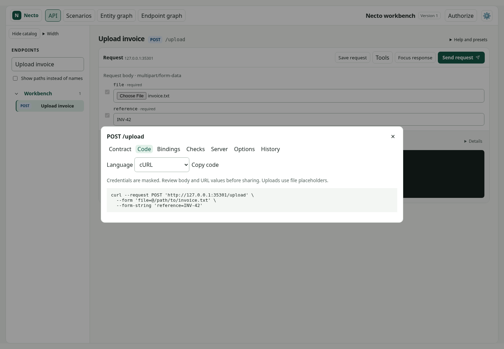
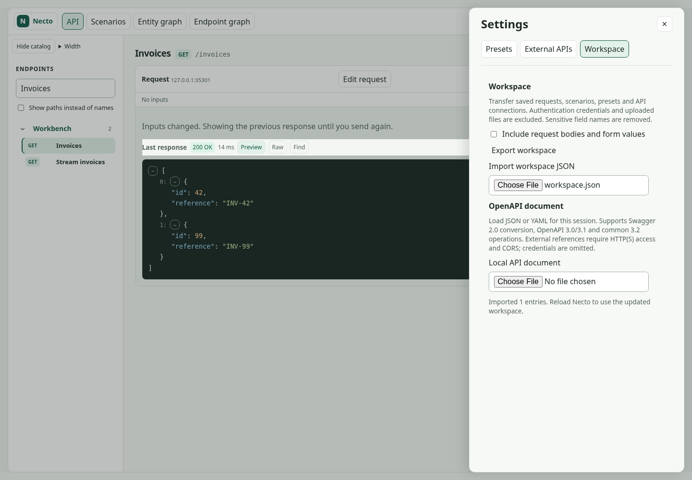

# API workbench

Necto keeps the endpoint catalog, value bindings and response preview in the main workspace. **Tools** opens supporting information on demand; **Settings → Workspace** handles document loading and transfers. There is no permanent inspector sidebar.

- Send multipart uploads, URL-encoded forms, JSON, text/XML and binary files.
- Inspect exposed HTTP headers and download original binary response bytes.
- Copy a prepared request as cURL, JavaScript fetch or C# HttpClient.
- Read request/response models and safe Markdown descriptions before sending.
- Choose an OpenAPI server, edit its variables, or save a default per API.
- Cancel individual requests and configure their timeout.
- Add response checks, replay scenarios, and run them in CI.
- Import/export a versioned workspace; load JSON/YAML documents.
- Compare recent responses and inspect bounded SSE/NDJSON streams.

## Space and interaction

**Tools** contains Contract, Code, Bindings, Checks, Server, Options and History. The dialog closes with Escape, returns focus to its trigger and adapts to a narrow screen. The active host sits beside the existing Request heading. Cancel appears only while a request is pending. A single body media type does not add a format selector.



Request bodies support multiple media types, named examples and schema variants. Changing the media type or variant preserves the draft for that choice within the active editor. File selections are never serialized: attach files again after loading a saved request or scenario. Optional fields can be excluded. Repeated form fields accept a JSON array. Browser-generated multipart boundaries are preserved.



Generated snippets use the same request builder and authentication application as Send, including serialized parameters and presets. Managed credentials and common sensitive names are masked. Files become explicit local-file placeholders. Review snippets before sharing: arbitrary text and identifiers can contain sensitive business data.

## Checks and stable scenarios

Checks support exact HTTP status, JSON Pointer existence/equality, nonempty values and a response-time ceiling. Equality values are JSON (`42`, `false`, `"PLN"`). Failed checks stop a scenario even when its HTTP status is successful. An explicitly matching status check can accept an expected error response. Invalid checks are rejected before sending.

In **Tools → Bindings**, an array binding can use an object condition instead of its saved position: for example `/reference` equals `"INV-42"`. Replay requires exactly one match and reports missing/ambiguous matches. Ordinary positional bindings remain available.

Native OpenAPI Links supplement Necto mappings for complete `$response.body#…` expressions targeting operationId or a local operationRef. Target parameters and whole request bodies are supported. Source status codes/ranges are respected in suggestions from successful responses. Header/request expressions, constant values, interpolated expressions, external operationRef and Link-specific server overrides are not executed. Existing Necto mappings remain the source for richer generated relationships.

## CI runner

Install the UI dependencies first (Node 22.12+ and pnpm), then run from the repository root:

```sh
pnpm --dir Necto.UI install --frozen-lockfile
node tools/necto-run.mjs \
  --scenario necto-workspace.json \
  --name 'Read an invoice' \
  --document openapi.yaml \
  --base-url https://api.example.com \
  --mappings endpoint-mappings.json \
  --bearer-env NECTO_CI_TOKEN \
  --report necto-report.json
```

The input can be one scenario, a scenario collection, or a workspace export. Include request bodies when exporting scenarios that need them. The runner validates operations/bindings, executes checks and exits nonzero on failure. The JSON report contains step status, timing and check outcomes; response bodies and credentials are excluded. Credentials come from the named environment variable and are sent only to the explicit base origin. Redirects fail. Mutating scenarios require `--allow-writes`. Browser login/OAuth interaction, uploaded files and preset activation are not reproduced by the CLI: supply the required nonsecret inputs in the scenario. Cross-API scenarios require separate runs; unavailable operations fail preflight.

## Workspace transfers

Exports contain saved requests, scenarios, presets, server defaults and API connections. Auth sessions, file bytes and browser layout preferences are excluded. Bodies/form values are opt-in. Common credential names and sensitive query parameters in URLs are scrubbed; arbitrary text cannot be classified reliably. Defaults are scoped by API document URL, so transfers between differently addressed installations may need adjustment.

Import validates format version and item shapes, previews storage-key conflicts and warns about scenario operations missing from the current catalog. Keep existing entries or explicitly replace conflicting collections. No imported request executes automatically. If writing fails, changed entries are rolled back. Reload Necto after importing stored configuration. Runtime preflight additionally checks that response mappings still exist.



## Document support

| Document feature | Support |
| --- | --- |
| OpenAPI 3.0 / 3.1 JSON and YAML | Common HTTP operation, parameter, security, body and response definitions |
| OpenAPI 3.2 | Partial; a visible notice lists unsupported areas; no full-conformance claim |
| Swagger 2.0 | Conversion of common schemas, servers, parameters, body/form data and response content; OAuth flow conversion and collectionFormat require review |
| Local file import | Session-only; does not upload the document to a Necto backend |
| External references | HTTP(S), up to 32 documents and 5 MB each; local references/cycles are preserved; requests omit credentials |
| Schema hints | Bounded required/type/enum/const, numeric/string/array bounds, allOf/oneOf/anyOf checks; discriminator-aware template selection |
| Full JSON Schema evaluation | Not provided: formats, patterns, unevaluatedProperties and all advanced dialect semantics remain API-side validation |

External reference requests need CORS. Relative HTTP references in imported files resolve against the configured document URL; local filesystem references and authenticated external references are not loaded. Markdown is sanitized before rendering. Unsupported schema rules are not presented as a validation success guarantee.

## Responses, history and streams

Response Details lists the headers the browser exposes. Cross-origin APIs need `Access-Control-Expose-Headers` for headers such as ETag and Content-Disposition; Set-Cookie remains browser-controlled. Binary downloads preserve bytes, prefer an exposed filename and otherwise use a media-type extension. They are not interpreted as text or embedded as active HTML/PDF.

History lives in memory, contains at most 20 requests and retains at most 250,000 characters per request/response pair and 1,000,000 characters overall. Credentials/common secret names are masked, oversized bodies omitted, and auth changes clear history. Clear history is available in Tools. Diffs compare the last two retained response values, with traversal and output limits.

SSE and NDJSON update while receiving. The preview closes the connection at 200 events or 1 MB, with a 64 KiB record guard. Malformed NDJSON records are labeled. Cancel and timeout apply to streams. Downloads contain the retained stream data, not unreceived events. GraphQL, WebSocket and arbitrary script execution are outside this feature.

## Validation

- UI unit tests cover existing behavior and the new transport, checks, snippets, references, schemas, workspace validation, bounded history, rules and CI runner.
- `Necto.UI/tests/workbench.e2e.cjs` serves an HTTP fixture and exercises upload bytes/boundaries, body formats, downloads, headers, dialogs, streaming, cancellation, timeout, imports and mobile layout.
- The existing authentication browser fixture verifies protected OpenAPI, Bearer/Basic/API keys/cookies/OIDC, related requests and scenario redaction.

To reproduce screenshots, build the UI and run the workbench fixture with `PLAYWRIGHT_MODULE`, `PLAYWRIGHT_BROWSERS_PATH` and `NECTO_WORKBENCH_SCREENSHOTS` pointing to your local Playwright installation, browser cache and output directory.

### CI failure diagnostics

JSON step reports include a 1-based `step` and a `failure` object with a stable
`code` and safe message. Codes distinguish `RESPONSE_LIMIT_EXCEEDED`, `TIMEOUT`,
`NETWORK_ERROR`, `BINDING_ERROR`, `HTTP_ERROR`, `ASSERTION_FAILED`,
`ORIGIN_MISMATCH`, `CANCELED` and the fallback `REQUEST_ERROR`.
Budget/timeout failures include `limitMiB`/`timeoutMs`; received HTTP failures
include `httpStatus`. JUnit uses the same codes and numeric context. Diagnostics
omit raw exception text, request URLs, headers and response values.
