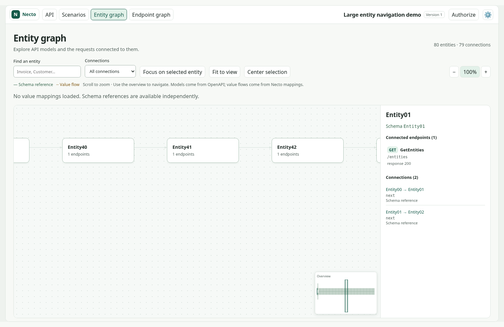

# Entity graph navigation

- Scroll the mouse wheel over the graph to zoom around the cursor. Trackpad wheel events work too; normal page scrolling remains available outside the graph.
- Click or drag the **Overview** in the lower-right corner to move the viewport. The outlined rectangle tracks the visible area; the selected entity is highlighted.
- **Fit to view**, **Center selection**, and the zoom buttons remain available. Zoom is proportional, so moving from a large fitted graph no longer requires repeated fixed-size increments.
- The overview follows the currently displayed entities and connection filters. The existing 100-entity display limit remains; search or focus selects the relevant part of larger APIs.



Browser verification with an 80-entity API:

```sh
PLAYWRIGHT_MODULE=/path/to/playwright node Necto.UI/tests/entity-navigation.e2e.cjs
```

Build the UI first with `npm run build --prefix Necto.UI`. Set `NECTO_ENTITY_SCREENSHOTS` to capture a preview.
