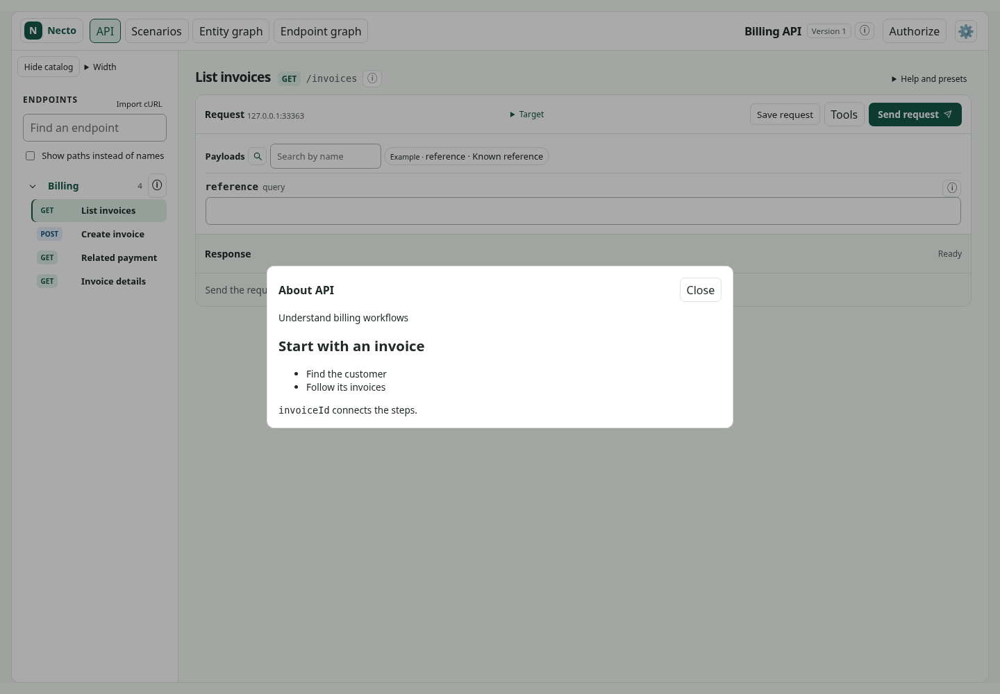
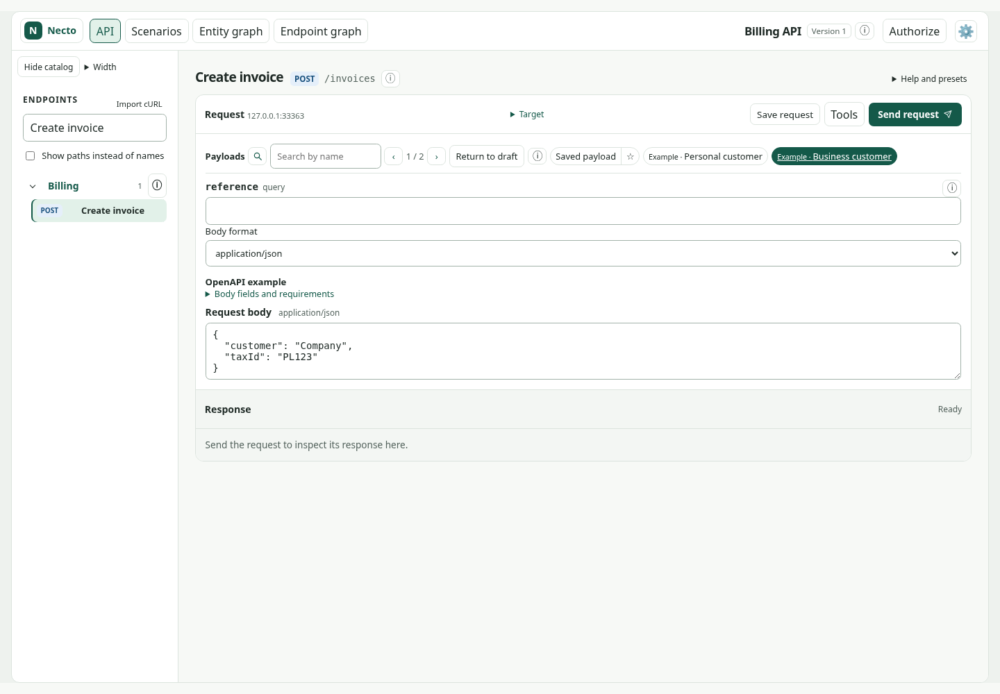
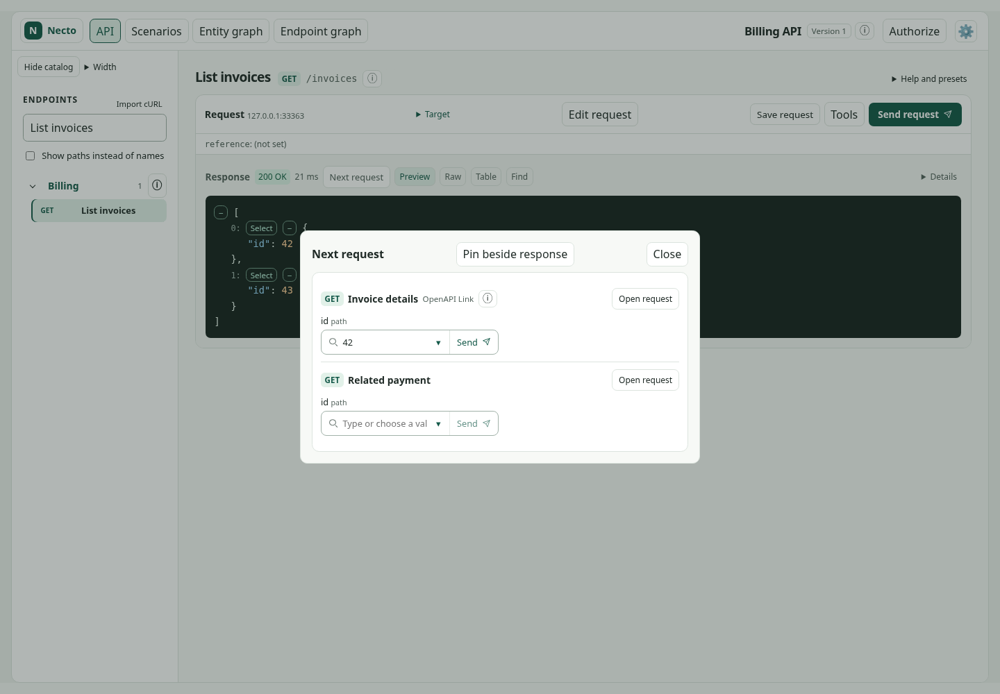
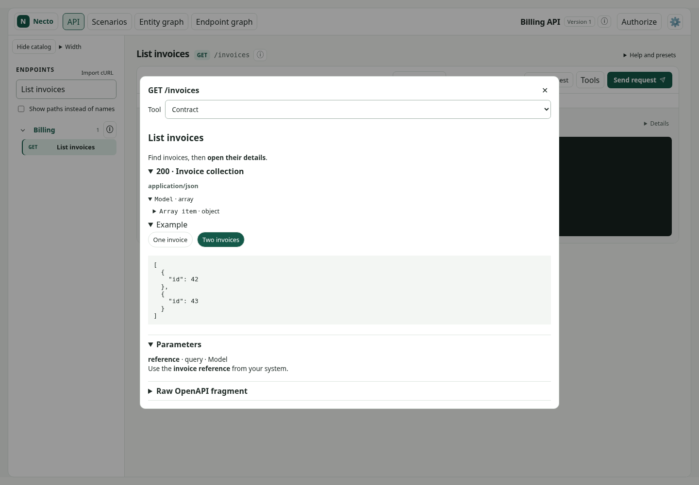
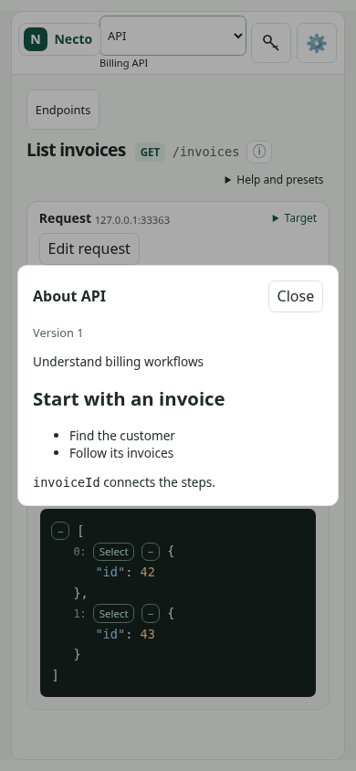

# OpenAPI content without losing response space

Necto uses the descriptions, examples and links already published in your OpenAPI document. No additional Necto configuration is required.

- **Descriptions:** the information button beside the API, endpoint, tag or parameter opens its summary/description on demand. On mobile, tap the existing API title. Markdown is sanitized; scripts, forms and remote images are not rendered. Contract field descriptions also support Markdown.
- **Examples:** the existing saved-request strip now includes labeled OpenAPI examples. Search and page through them, load one into the draft, or return to the draft from before example browsing. Loading a saved request starts a new draft context. Examples never send requests. Named examples and local references, media-level `example`, and schema example values are supported. Parameter examples fill only their field. JSON, text/XML and structured form examples use the appropriate editors; files require attachment. External example files are labeled unavailable and never fetched.
- **Response examples:** switch among published examples in Contract using compact chips. These are documentation, not actual API responses, and do not enter response history or value bindings. Large example previews are truncated explicitly, while applying a request example uses its full value.
- **Links:** valid OpenAPI Links appear before additional Necto mappings and carry an OpenAPI Link label. Duplicate field/value suggestions preserve Link provenance. One unambiguous declared value is suggested ahead of additional inferred values; an explicit object selection still wins. Author descriptions open on demand. Exact response codes override ranges; `default` applies only when no declared code/range matches. Missing response values leave generated mappings available as fallback.

Supported Link values include complete `$response.body#…` pointers and literals, path/query/header targets, whole request bodies, and links without parameters. Destinations use a unique operationId in the same API or a local operationRef. Unsupported request/header runtime expressions, interpolations, external operationRef, cookie parameters and Link-specific server overrides are not executed. Selecting a Link still uses the normal request editor, presets, validation and authorization. Links describe possible next calls; they do not guarantee business validity or automatically run writes.

Validation: 185 module tests, production build and `Necto.UI/tests/openapi-content.e2e.cjs` in Chromium at 1440px and 390px. The browser fixture checks Markdown sanitization/focus, no extra header row, saved/example switching, draft restoration, local references, unavailable external examples, Links ordering and response examples. All data and APIs are synthetic.

