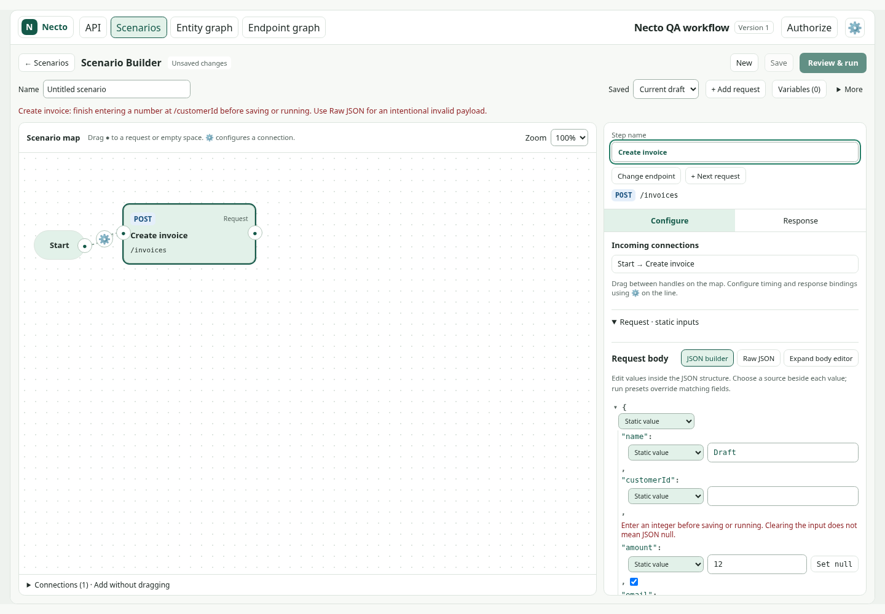

# QA01: Prevent empty numeric body fields from silently becoming null

Keep unfinished numeric edits separate from JSON and block saving/running until resolved. Explicit nullable Set null and intentional Raw JSON negative payloads remain available. Add the missing JSON textarea to the existing Raw view.

Validation: 285 UI/module tests and production UI build passed. Browser test `qa01-number-editing.e2e.cjs` covers: Blank/zero/null behavior, raw editing, actual dispatch, pending-edit validation and array-index rebasing.

Run after building the UI:

```sh
PLAYWRIGHT_MODULE=/path/to/playwright node Necto.UI/tests/qa01-number-editing.e2e.cjs
```

Set `NECTO_QA_SCREENSHOTS` to capture a preview.


