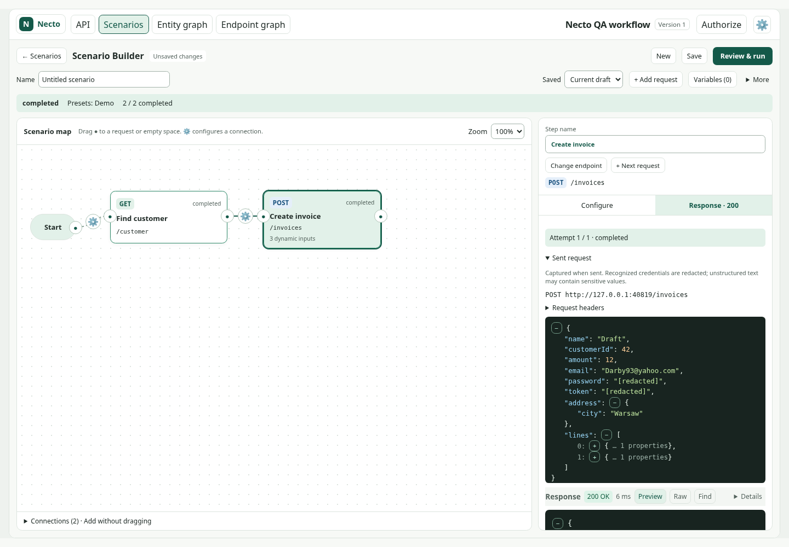

# QA02: Inspect the request actually sent by a scenario step

Add a collapsed Sent request section with dispatched method, URL, redacted headers and body. Capture after dynamic/preset resolution; bound large/deep previews so diagnostics cannot block dispatch.

Validation: 285 UI/module tests and production UI build passed. Browser test `qa02-sent-request.e2e.cjs` covers: Response/Faker/preset values, actual POST, credential redaction, stale-run context and oversized/deep body fallbacks.

Run after building the UI:

```sh
PLAYWRIGHT_MODULE=/path/to/playwright node Necto.UI/tests/qa02-sent-request.e2e.cjs
```

Set `NECTO_QA_SCREENSHOTS` to capture a preview.


