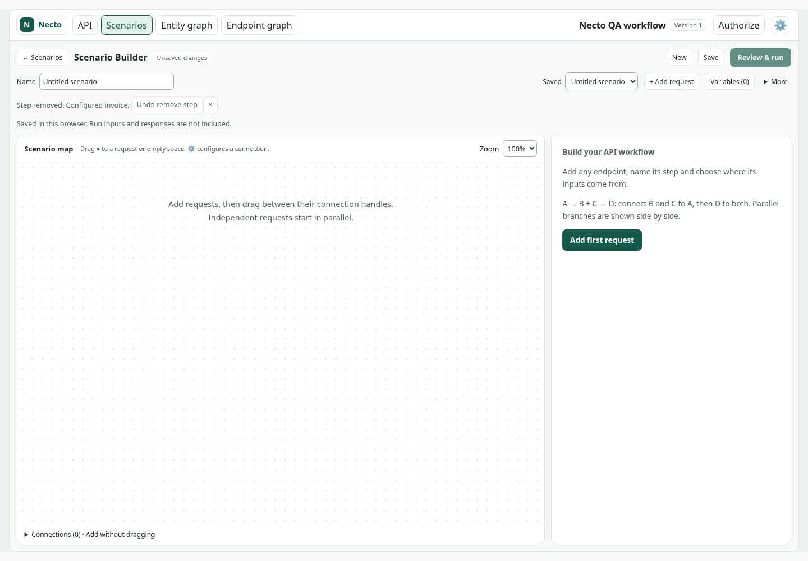

# QA03: Undo removal of a Scenario Builder step

Offer one-step Undo after removal. Restore configuration, placement, bindings and timing while retaining later edits; guard conflicts and scenario/run boundaries. Unfinished drafts can also be restored.

Validation: 286 UI/module tests and production UI build passed. Browser test `qa03-undo-step.e2e.cjs` covers: Exact request restoration, changed consumer preservation, conflicting bindings, unfinished drafts and reset on new scenario.

Run after building the UI:

```sh
PLAYWRIGHT_MODULE=/path/to/playwright node Necto.UI/tests/qa03-undo-step.e2e.cjs
```

Set `NECTO_QA_SCREENSHOTS` to capture a preview.


