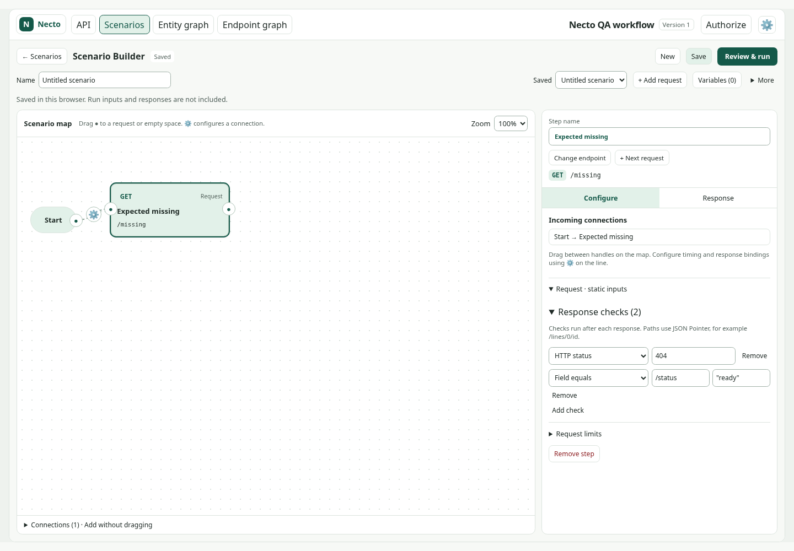

# QA04: Configure response checks in Scenario Builder

Expose a collapsed Response checks section using a shared editor extracted from Request Tools. Reuse existing assertion types and runner semantics, including expected error statuses.

Validation: 283 UI/module tests and production UI build passed. Browser test `qa04-response-checks.e2e.cjs` covers: Status and field checks, saved definition, expected 404 success and unexpected status failure.

Run after building the UI:

```sh
PLAYWRIGHT_MODULE=/path/to/playwright node Necto.UI/tests/qa04-response-checks.e2e.cjs
```

Set `NECTO_QA_SCREENSHOTS` to capture a preview.


