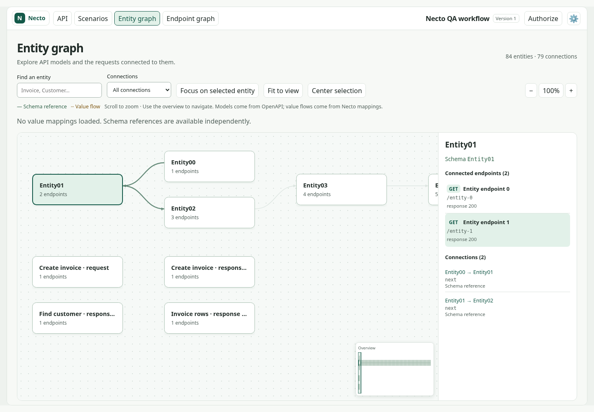

# QA05: Center the entity reached through a relationship

Center only navigation from the relationship list, preserving zoom. Clicking a visible graph card retains its existing behavior.

Validation: 283 UI/module tests and production UI build passed. Browser test `qa05-entity-follow.e2e.cjs` covers: An offscreen relationship target becomes visible without a second Center selection action; zoom is preserved.

Run after building the UI:

```sh
PLAYWRIGHT_MODULE=/path/to/playwright node Necto.UI/tests/qa05-entity-follow.e2e.cjs
```

Set `NECTO_QA_SCREENSHOTS` to capture a preview.


