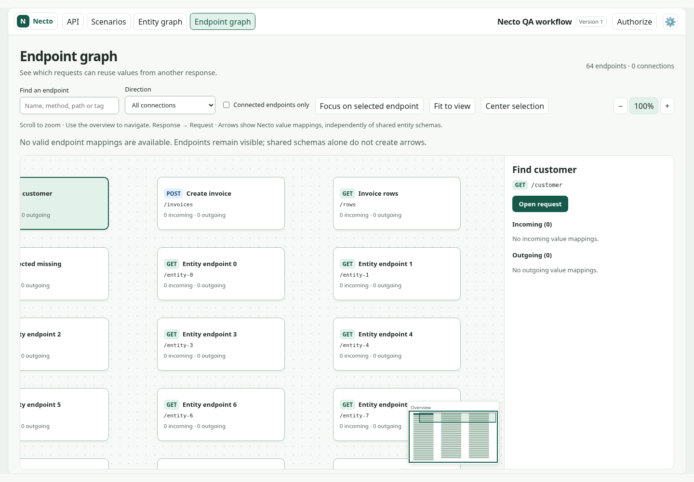

# QA06: Use consistent wheel zoom and minimaps across both graphs

Share graph navigation/minimap components with Endpoint graph, parameterize node dimensions and add keyboard overview navigation to both graphs. Preserve filters, Fit and Center.

Validation: 283 UI/module tests and production UI build passed. Browser test `qa06-graph-parity.e2e.cjs` covers: Wheel zoom in both graphs, minimap End/Home/arrow navigation, viewport updates and mobile overflow.

Run after building the UI:

```sh
PLAYWRIGHT_MODULE=/path/to/playwright node Necto.UI/tests/qa06-graph-parity.e2e.cjs
```

Set `NECTO_QA_SCREENSHOTS` to capture a preview.


