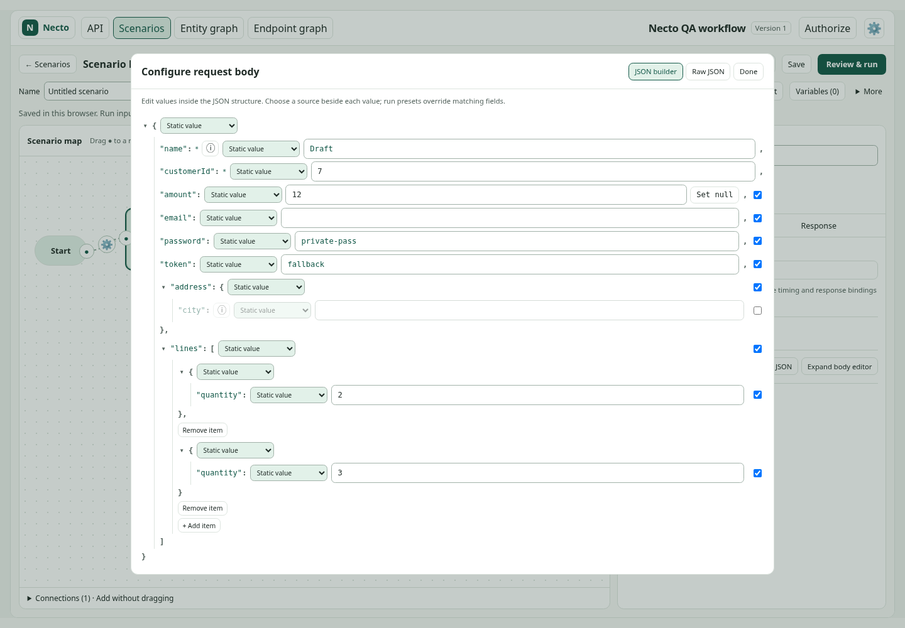

# QA07: Dim omitted JSON body fields and expose compact field help

Dim omitted fields while keeping Include controls usable, as requested. Add compact required markers and accessible field-description help without permanent descriptions under every key.

Validation: 283 UI/module tests and production UI build passed. Browser test `qa07-omitted-fields.e2e.cjs` covers: Omitted property excluded from saved body, actual dimming, re-inclusion, required/help controls and mobile help.

Run after building the UI:

```sh
PLAYWRIGHT_MODULE=/path/to/playwright node Necto.UI/tests/qa07-omitted-fields.e2e.cjs
```

Set `NECTO_QA_SCREENSHOTS` to capture a preview.


