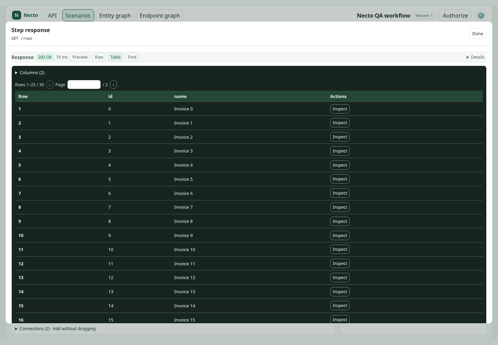

# QA08: Expand scenario responses without losing preview state

Add an optional wider response dialog using Teleport to retain the existing preview instance. Preserve Raw/Table/Find state, focus return and stale-run indication.

Validation: 283 UI/module tests and production UI build passed. Browser test `qa08-expand-response.e2e.cjs` covers: Wide preview, Raw/Preview state, Find, table mode, Escape/focus restoration and mobile layout.

Run after building the UI:

```sh
PLAYWRIGHT_MODULE=/path/to/playwright node Necto.UI/tests/qa08-expand-response.e2e.cjs
```

Set `NECTO_QA_SCREENSHOTS` to capture a preview.


