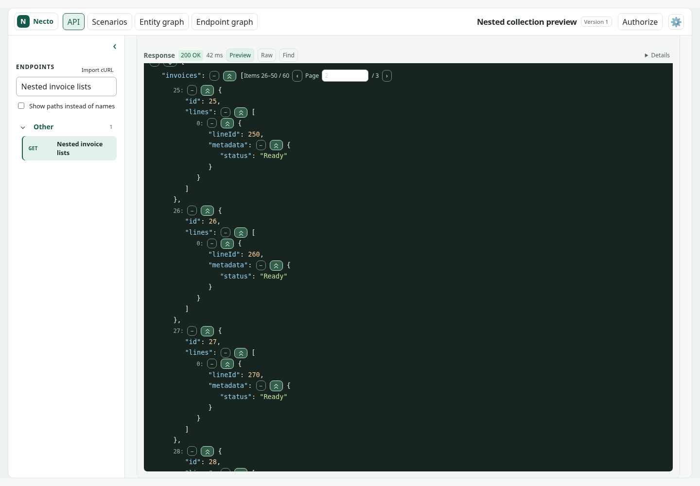

# Expand response children

In **Response → Preview**, each non-empty list and object has a compact **double-chevron** button beside its existing +/− control. Downward chevrons expand children; upward chevrons collapse them. Hover for a tooltip, or use its accessible label. Click to expand children in that branch; click again to collapse the children while keeping that list/object open. Other branches stay unchanged.

- Paging stays active. Only the visible page of each collection is expanded; moving to another page expands that page's children too.
- Each branch expansion is bounded to 500 JSON values and 16 levels. If some branches remain collapsed, the preview explains this; individual expansion and Find remain available.
- A new response restores the existing default expansion rules. Raw/Preview switching preserves branch choices for the current response.
- The control is available in the normal and expanded scenario response preview. XML retains its existing controls.



Validation: 293 UI/module tests, production UI build, and Chromium checks for independent sibling branches, nested overrides, hover hints, later pages, search reveal, mode switching, response reset, mobile layout and a payload with 250,000 nested rows. Existing XML and expanded-response browser regressions passed.

```sh
PLAYWRIGHT_MODULE=/path/to/playwright node Necto.UI/tests/preview-expansion.e2e.cjs
```

Build the UI first. Set `NECTO_EXPANSION_SCREENSHOTS` to save a preview.
