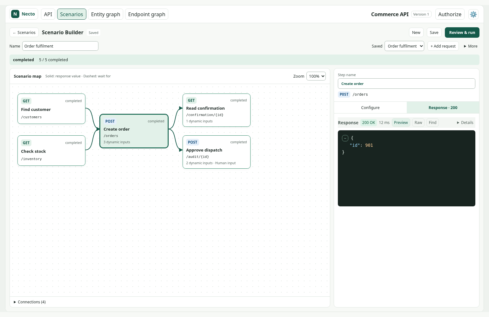
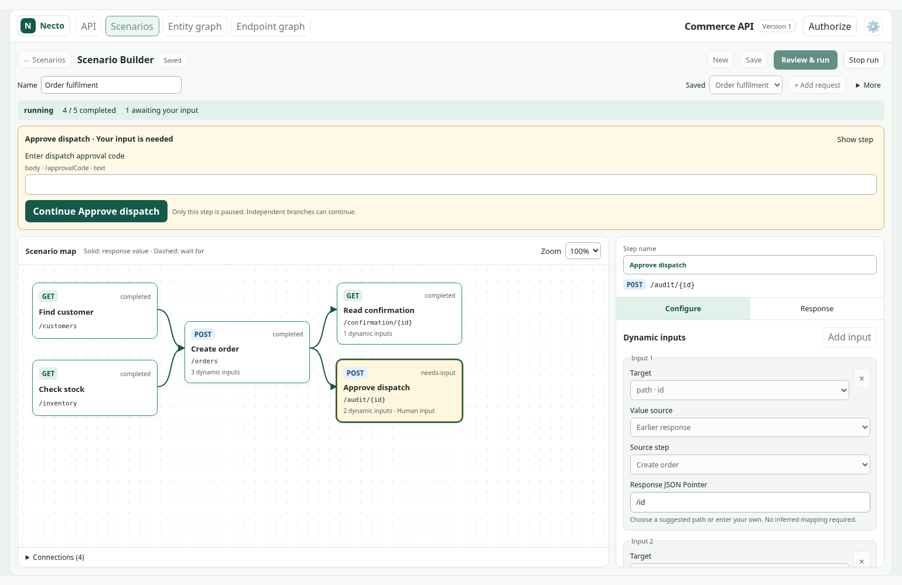

# Scenario Builder

Build a workflow, not just a replay of a request chain.

- **Parallel branches and joins:** run several requests, combine their responses in another, then branch again.
- **Your connections:** add any visible endpoint, including external APIs and endpoints Necto did not link. Reuse the same endpoint in multiple named steps.
- **Four input sources:** static request values, an earlier JSON response, generated data, or a question asked before sending.
- **A readable map:** named request cards, dependency arrows and live status. Select a card to configure it or inspect its response.

Open **Scenarios → Scenario Builder**. The existing **Save Scenario** remains the quick way to replay a linear chain.



## Build a workflow

1. **Add request**, search any endpoint, and give the step a useful name.
2. Edit **Request · static inputs** for fixed parameters and the request body. Current presets and API server settings also apply when you review/run.
3. Add a **Dynamic input** and choose its target: path/query/header parameter, a JSON body field, or the whole body.
4. Choose **Earlier response**, **Generate data** or **Ask at run time**.
5. Use **Wait for** to add an ordering dependency without copying a value. A response input adds its own dependency automatically.
6. **Save**, then **Review & run** to inspect API targets and choose parallelism/human-in-the-loop mode before sending.

Independent steps start together. A step waits for *all* its dependencies. Solid arrows carry response data; dashed arrows only impose ordering. Cycles, missing endpoints and overlapping input targets prevent a run. Static request preparation is checked for every step before any request is sent; response values are resolved only after their source succeeds. Dynamic inputs take precedence over matching presets.

For example:

```text
Find customer ──┐                  ┌── Read confirmation
                ├── Create order ──┤
Check stock ────┘                  └── Approve dispatch [human input]
```

Each run uses fresh responses. Missing response values fail the receiving step instead of falling back to old IDs. Existing request authentication, serialization, timeouts, response budgets and response preview are reused.

## Response fields

Use **JSON Pointer** paths: `/items/0/id`, `/customer/id`, or an empty pointer for the whole JSON value. Escape `/` in a property name as `~1`, and `~` as `~0`. Suggestions come from the source's OpenAPI response schema and, when available, the previous run. Array suggestions use index `0`; change the index when needed. No inferred relationship is required.

JSON values keep their type when written into JSON request bodies. Target array positions must already exist in the static body. For text/XML request bodies, an empty target pointer replaces the whole body. Response extraction currently reads JSON; XML parsing/XPath and dynamic form/file fields are not part of this version. Static forms and attached files use the existing body editor; files must be reattached after reopening a saved definition.

Editing a definition marks previous results as belonging to the previous run. They remain available as a reference; they never become the next run's input values.

## Human in the loop

Mark a field **Ask at run time**, give it a question and choose text, number, boolean or JSON. When its dependencies finish, the step pauses before sending. Enter the value and choose **Continue**.

Several steps may ask questions independently. Waiting for an answer does not occupy a network slot, so independent requests continue even when parallelism is one. **Stop run** cancels pending prompts and stops scheduling requests. Human inputs require the run's human-in-the-loop option to be enabled.



## Generated data

Choose a **Generator tag**: UUID, names, email, username, company, city, country code, integer (0–1000), boolean, current ISO timestamp, or a bounded pattern. Faker's English locale is downloaded with the UI and loaded on demand when a generator is used, with no external generation service. Values are generated anew for each run; use response bindings to pass one generated value onward through an API response.

Pattern example: `INV-[A-Z]{3}-\d{4}`.

Supported: literals, character ranges/classes, `\d`, `\w`, `\s` (a space), `?`, `{n}` and `{min,max}`, with optional outer `^`/`$`. Repetitions are limited to 32 and total output to 256 characters. Groups, alternatives, lookarounds and unbounded repetition are rejected. Patterns are parsed as a bounded generation language, never executed as arbitrary regex or code. Generated data is not schema-aware: choose a category compatible with the API field and its constraints.

## Save and share

- Definitions are saved per API workspace in this browser. Use **More → Export definition / Import definition** to share a JSON definition. Workspace backups also include Builder definitions.
- Static inputs are included: review them before sharing and keep credentials in **Authorize** or presets. Human answers, generated run values, results and file contents are excluded from saved/exported definitions. Normal in-memory request history remains available.
- An imported definition becomes a new draft; importing, opening and saving never send requests.
- **More → Copy quick scenario** copies a saved linear chain without modifying it. Fixed response paths are supported; filtered array selectors require configuring a response pointer manually.
- Limits: 100 steps, 1–8 simultaneous HTTP requests, 100 saved definitions and 2 MB of saved definitions per workspace; individual imports/exports are limited to 2 MB.

A failure stops scheduling new steps and aborts in-flight requests where possible. Completed writes cannot be rolled back, and requests are never retried automatically. Execution happens in the browser, so the tab must remain open. This version does not add a background scheduler, loops, conditional branches or a CLI format; the existing quick-scenario CI runner is unchanged.

## Validation

From the repository root:

```sh
node --test Necto.UI/src/features/*/*.test.js
npm run build --prefix Necto.UI
node Necto.UI/tests/scenario-builder.e2e.cjs
```

The browser test needs Playwright and Chromium; it honors `PLAYWRIGHT_MODULE`, `PLAYWRIGHT_BROWSERS_PATH` and `NECTO_BUILDER_SCREENSHOTS`. It builds a five-step workflow through the UI and verifies actual parallel HTTP requests, a join of two JSON responses, Faker generation, fan-out, human pause/resume/cancel, saved-definition reload and mobile layout.
