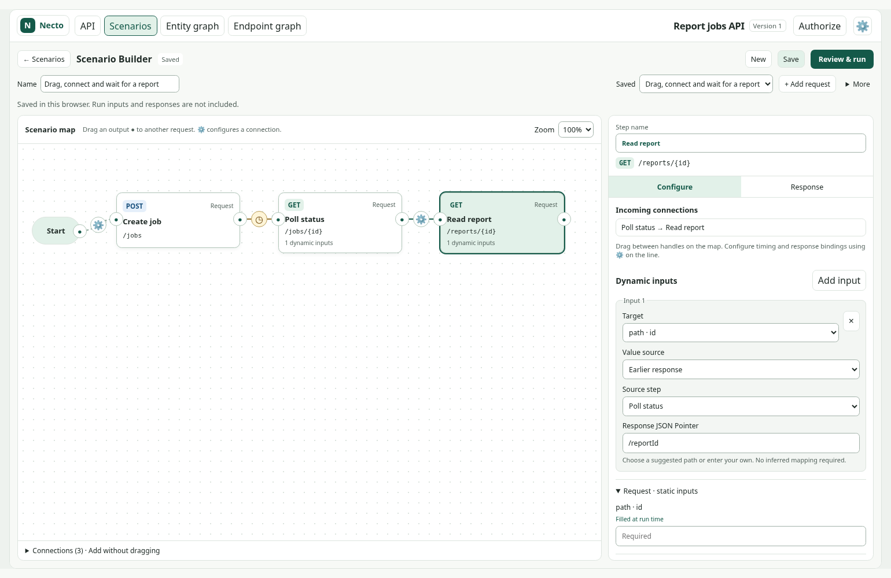
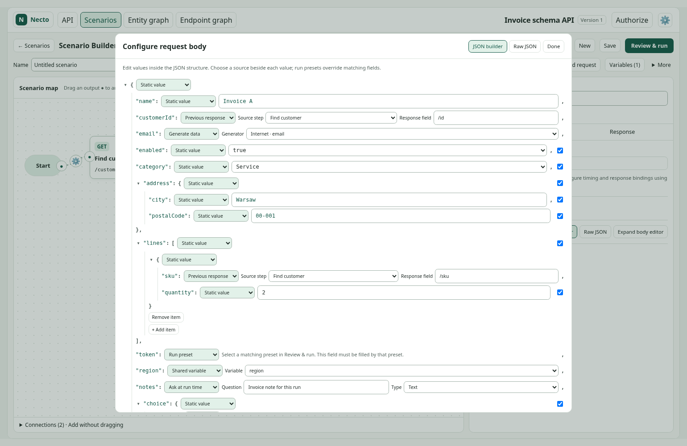
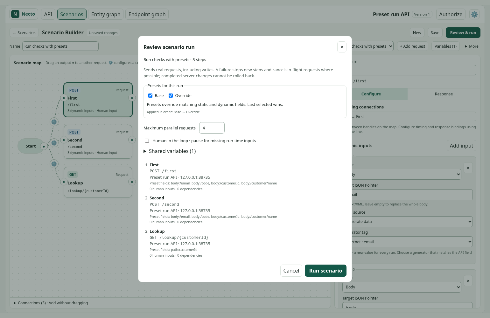
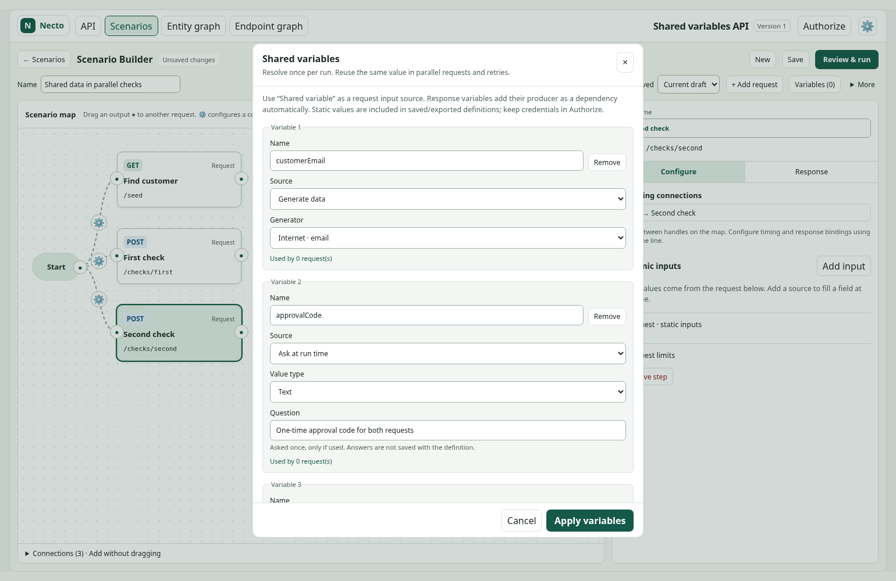
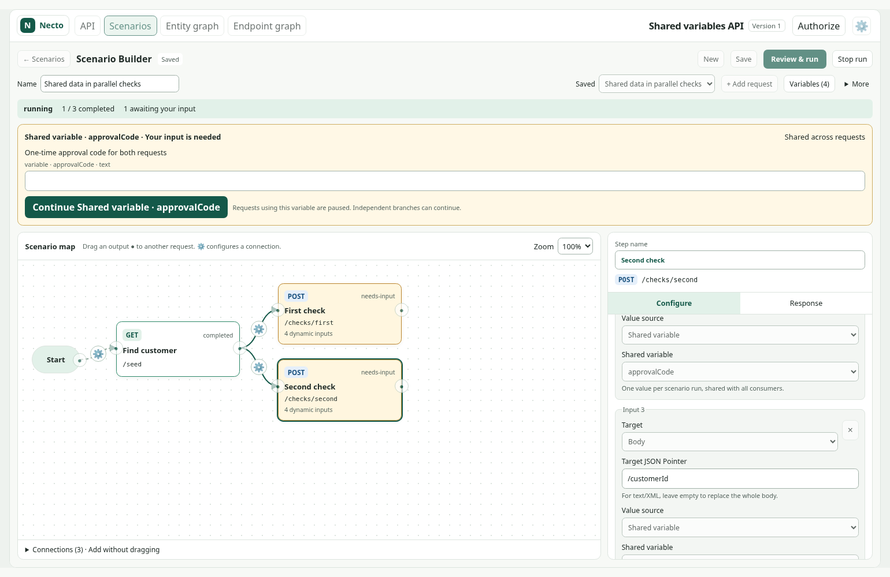
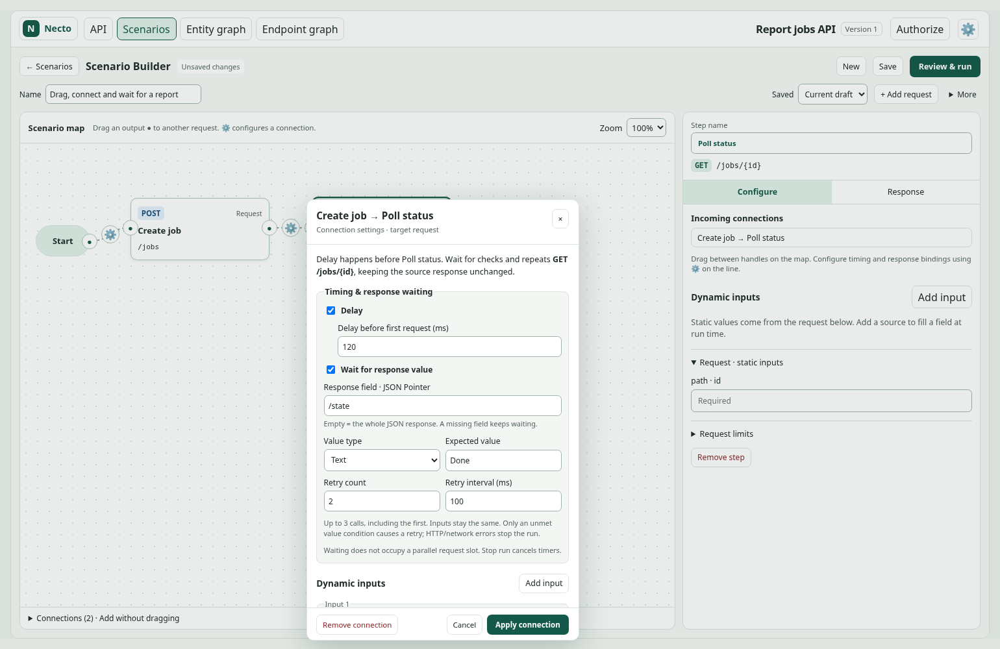

# Scenario Builder

Build a workflow, not just a replay of a request chain.

- **Parallel branches and joins:** run several requests, combine their responses in another, then branch again.
- **Your connections:** add any visible endpoint, including external APIs and endpoints Necto did not link. Reuse the same endpoint in multiple named steps.
- **Four input sources:** static request values, an earlier JSON response, generated data, or a question asked before sending.
- **A readable map:** named request cards, dependency arrows and live status. Select a card to configure it or inspect its response.

Open **Scenarios → Scenario Builder**. The existing **Save Scenario** remains the quick way to replay a linear chain.



## Build a workflow

1. **Add request**, search any endpoint, and give the step a useful name.
2. Edit **Request · static inputs** for fixed parameters and the request body. Generated values and human prompts remain in the request's **Dynamic inputs**.
3. **Drag the output handle ● to another request's input handle** to connect them. You can also tap/click an output and then an input, or use **Connections → Add without dragging** with the keyboard.
4. Click **⚙ on the line** to open its settings next to that connection. Configure Delay, Wait for, and response values to copy from the source into the target. Choose a target parameter/JSON body path and a source response JSON Pointer; inferred mappings are not required.
5. Choose **Apply connection** to save popup edits. **Cancel**, Escape and clicking outside discard those edits. The connection created by a drag remains; use **Remove connection** to delete it. Removing a connection also removes its response bindings after confirmation.
6. **Save**, then **Review & run** to inspect targets, incoming policies and parallelism before sending.

A connection **A → B** waits for A, then governs request **B**. Delay happens before B's first request; Wait for checks B's response and repeats B if needed. It never replays A. Solid lines carry response values; dashed lines only impose ordering. A clock icon identifies a connection with timing settings. The **Start → request** line lets you configure an independent/root request; resetting that line clears its settings without deleting the request.

At a join, all source requests must finish before the target starts. Incoming delays overlap, so the longest delay applies. All incoming response conditions must match the *same target response*, using one shared target request per attempt. An unmet condition fails when its own retry count is exhausted; the next interval is the longest interval among currently unmet conditions. A condition is checked on every attempt, even if it matched an earlier response.

Cycles, self-links, missing endpoints and conflicting input targets are rejected. Dragging an existing connection opens its settings instead of creating a duplicate. Escape cancels an unfinished drag. Use zoom or scroll the map to reach another request; the connection list is an alternative on small screens. During a run, connections can be inspected but not edited.

Static request preparation is checked for every step before sending. Each run uses fresh responses; missing bound values fail the target rather than reusing old IDs. Selected run presets take precedence over matching static and dynamic inputs. Existing authentication, serialization, request limits and response preview are reused.

For example:

```text
Find customer ──┐                  ┌── Read confirmation
                ├── Create order ──┤
Check stock ────┘                  └── Approve dispatch [human input]
```

Each run uses fresh responses. Missing response values fail the receiving step instead of falling back to old IDs. Existing request authentication, serialization, timeouts, response budgets and response preview are reused.

## Configure request bodies from the schema

JSON requests open in **Request body → JSON builder**. Editable values sit directly beside quoted JSON keys, with braces, brackets, commas and indentation showing the payload structure. Objects and array items start expanded through four levels; deeper branches can be expanded on demand. The tree shows named properties, types/formats, required/read-only flags, nested objects, array items, enums and selected `oneOf`/`anyOf` variants. Referenced schemas and `allOf` properties are resolved into that tree. Optional properties can be included or removed.

At each field, choose:

- **Static value** — type a value, choose an enum/boolean, or edit an opaque JSON object.
- **Previous response** — choose a source request and response path; suggestions include the OpenAPI schema and available previous results.
- **Shared variable** — select an existing run variable.
- **Run preset** — explicitly require a matching selected preset. Run review reports missing matches and lets you choose the preset before sending.
- **Generate data / Ask at run time** — configure Faker/patterns or a typed human question at that field.

Use **Expand body editor** for a wider workspace. Closing it keeps your draft edits. Objects can receive one source for the entire object or separate sources for their children; replacing a configured subtree asks before removing its child bindings. Array controls add/remove items and update later binding indexes. Variant selection preserves its UI metadata on save; raw edits/discriminators also help identify the selected branch.

**Raw JSON** remains available, including the existing body editor's media/form/file controls. **Advanced body bindings** provides direct JSON Pointer editing. Non-JSON bodies retain their existing editor. Additional properties and recursive/deep branches can be edited as JSON rather than eagerly expanding an unbounded tree. Large property lists and arrays have explicit “Show more” controls; schema fields are not silently truncated.

Explicit Run preset sources apply to named fields, not the entire body. Presets still override matching fields regardless of the selected source. New definitions use v5 so older clients reject these new source rules; existing v1–v4 definitions still open. There is no scripting or automatic inference of cross-API business meaning.



## Run with presets

Choose **Review & run → Presets for this run**. Active API presets are initially selected; you can select a different set or clear them for this run. The displayed order matters: the **last selected preset wins** when fields overlap. This does not change the global active presets or the saved scenario.

Presets override matching path/query/header parameters and JSON body properties, including nested objects and array items, using the normal preset name-matching rules. Values keep their schema/JSON types. Unmatched fields retain their static, response, generated, human or shared-variable source.

- A fully covered dynamic input is skipped: no unnecessary question, generation or response-field lookup.
- Partial JSON object/whole-body bindings still resolve their other data; presets are reapplied to matching fields in the final outgoing body.
- Graph dependencies and connection timing remain unchanged. Presets override request fields, not the shared variable definition itself.
- External APIs still honor their existing shared-presets opt-in.

Run review lists matching field paths without exposing their values. You can select a preset to fill a required field even if the initial review reports it missing. **No presets** uses the scenario's own inputs. Retry attempts use the same selected values, and the execution bar records the chosen preset names.



## Response fields

Use **JSON Pointer** paths: `/items/0/id`, `/customer/id`, or an empty pointer for the whole JSON value. Escape `/` in a property name as `~1`, and `~` as `~0`. Suggestions come from the source's OpenAPI response schema and, when available, the previous run. Array suggestions use index `0`; change the index when needed. No inferred relationship is required.

JSON values keep their type when written into JSON request bodies. Target array positions must already exist in the static body. For text/XML request bodies, an empty target pointer replaces the whole body. Response extraction currently reads JSON; XML parsing/XPath and dynamic form/file fields are not part of this version. Static forms and attached files use the existing body editor; files must be reattached after reopening a saved definition.

Editing a definition marks previous results as belonging to the previous run. They remain available as a reference; they never become the next run's input values.

## Shared variables

Open **Variables** in the Builder toolbar and define a name and source. In a request's **Dynamic inputs**, choose **Shared variable** and select that name. Bind it to any supported parameter, JSON field or whole body.

| Source | Behavior |
| --- | --- |
| Static value | A typed text, number, boolean or JSON constant. Included in saved/exported definitions. |
| Generate data | Faker/category/pattern evaluated once when first used, then reused by every consumer. A new run generates a new value. |
| Ask at run time | One question per run, even when several parallel requests need the answer. Requires human-in-the-loop mode. |
| Response field | A JSON Pointer from a source step's final successful response, after any response waiting finishes. Consumers automatically depend on that producer. |

For example, generate `customerEmail` once, ask for `approvalCode` once and capture `customerId` from a lookup. Two parallel checks can use the same three values, plus a static JSON `metadata` object. Polling retries keep those same inputs.



Variables resolve on demand: unused generators do not run and unused human variables do not ask questions. Waiting for a shared answer consumes no HTTP slot. Missing response fields fail consumers rather than reusing an old value. Variable dependencies participate in cycle validation and appear as data-carrying connections on the map.

Names contain letters, digits and underscore, start with a letter/underscore and are unique ignoring case. Bindings use stable IDs, so renaming is safe. Removing a used variable is blocked until its input bindings are changed. Removing a step used as a response-variable producer is also blocked. Up to 100 variables are supported.

The editor applies changes atomically; Cancel/Escape discard edits. Definitions are read only during a run. Run values are never written back to the definition or workspace backup; normal in-memory request/response history can still contain sent values. Static values are persisted, so keep credentials in **Authorize**. Variables are scoped to one run, not shared globally across scenarios, and this feature does not evaluate scripts or expand string templates.



## Human in the loop

Mark a field **Ask at run time**, give it a question and choose text, number, boolean or JSON. When its dependencies finish, the step pauses before sending. Enter the value and choose **Continue**.

Several steps may ask questions independently. Waiting for an answer does not occupy a network slot, so independent requests continue even when parallelism is one. **Stop run** cancels pending prompts and stops scheduling requests. Human inputs require the run's human-in-the-loop option to be enabled.


## Delay and response-value waiting

Click the connection's gear/clock icon to open **Timing & response waiting**. These settings belong to that connection and govern its target request:

- **Delay:** wait once after dependencies finish and before preparing inputs or asking a human, then send the first request. Configure 0–600000 ms.
- **Wait for response value:** choose a JSON Pointer, expected value and type, retry count and interval. For example, poll `/jobs/{id}` until `/state` equals the text `Completed`, then let dependent requests use that matching response.
- **Retry count** excludes the initial request: 5 retries allow at most 6 calls. A count of 0 checks the first response without repeating. Retry counts are limited to 100; intervals to 100–600000 ms. The interval starts after an unsuccessful condition check; queued requests can wait longer when concurrency is full.

Missing fields keep waiting. Values use exact typed equality: number `1` is different from text `1`; JSON object key order does not matter. JSON `null` is distinct from a missing field. Normal response checks must pass on the final matching response. A non-JSON response, network error or unsuccessful HTTP response stops execution immediately (unless an existing explicit status assertion accepts that HTTP status).

Inputs, generated values and human answers are prepared once and reused across polling attempts. The initial delay is not repeated. Timers do not occupy HTTP concurrency slots, and **Stop run** cancels them. Only the final matching response releases downstream steps. Exhaustion fails the step, skips its dependents and retains the last response plus a compact attempt history for inspection.

Use a read endpoint to poll asynchronous work. If you enable waiting on POST/PUT/PATCH/DELETE, it repeats that request and can repeat server changes. The run review shows the HTTP method, maximum call count and interval before sending. There is no automatic retry policy for ordinary requests.

Newly saved/exported definitions use format version 5, which older Builder versions reject rather than ignoring connection settings. Existing version 1/2/3/4 definitions still open and upgrade when saved. Old per-step timing is moved to one incoming connection, or a Start connection for a root request; join delays and polling behavior are preserved. The tab must remain open; browser timer throttling can lengthen waits.



See [production workflow recommendations](production-workflows.md) for useful next steps beyond fixed delays and equality polling.

## Generated data

Choose a **Generator tag**: UUID, names, email, username, company, city, country code, integer (0–1000), boolean, current ISO timestamp, or a bounded pattern. Faker's English locale is downloaded with the UI and loaded on demand when a generator is used, with no external generation service. Values are generated anew for each run; use response bindings to pass one generated value onward through an API response.

Pattern example: `INV-[A-Z]{3}-\d{4}`.

Supported: literals, character ranges/classes, `\d`, `\w`, `\s` (a space), `?`, `{n}` and `{min,max}`, with optional outer `^`/`$`. Repetitions are limited to 32 and total output to 256 characters. Groups, alternatives, lookarounds and unbounded repetition are rejected. Patterns are parsed as a bounded generation language, never executed as arbitrary regex or code. Generated data is not schema-aware: choose a category compatible with the API field and its constraints.

## Save and share

- Definitions are saved per API workspace in this browser. Use **More → Export definition / Import definition** to share a JSON definition. Workspace backups also include Builder definitions.
- Static inputs are included: review them before sharing and keep credentials in **Authorize** or presets. Human answers, generated run values, results and file contents are excluded from saved/exported definitions. Normal in-memory request history remains available.
- An imported definition becomes a new draft; importing, opening and saving never send requests.
- **More → Copy quick scenario** copies a saved linear chain without modifying it. Fixed response paths are supported; filtered array selectors require configuring a response pointer manually.
- Limits: 100 steps, 1–8 simultaneous HTTP requests, 100 saved definitions and 2 MB of saved definitions per workspace; individual imports/exports are limited to 2 MB.

A failure stops scheduling new steps and aborts in-flight requests where possible. Completed writes cannot be rolled back, and requests are repeated only when a step explicitly enables response-value waiting. HTTP and network errors are not retried by that setting. Execution happens in the browser, so the tab must remain open. This version does not add a background scheduler, loops, conditional branches or a CLI format; the existing quick-scenario CI runner is unchanged.

## Validation

From the repository root:

```sh
node --test Necto.UI/src/features/*/*.test.js
npm run build --prefix Necto.UI
node Necto.UI/tests/scenario-builder.e2e.cjs
node Necto.UI/tests/scenario-waiting.e2e.cjs
node Necto.UI/tests/scenario-connections.e2e.cjs
node Necto.UI/tests/scenario-variables.e2e.cjs
node Necto.UI/tests/scenario-presets.e2e.cjs
node Necto.UI/tests/scenario-body-schema.e2e.cjs
```

The browser test needs Playwright and Chromium; it honors `PLAYWRIGHT_MODULE`, `PLAYWRIGHT_BROWSERS_PATH` and `NECTO_BUILDER_SCREENSHOTS`. It builds a five-step workflow through the UI and verifies actual parallel HTTP requests, a join of two JSON responses, Faker generation, fan-out, human pause/resume/cancel, saved-definition reload and mobile layout.

The waiting browser test exercises an asynchronous job: start once, delay, poll until ready, then fetch the resulting report. It also verifies attempt limits, spacing, independent progress with parallelism one, persistence, exhaustion, cancellation and mobile layout. Screenshots use `NECTO_WAIT_SCREENSHOTS`.

The connection browser test verifies real mouse drags, an anchored popup, response bindings, cancellation of edits, invalid/cyclic/duplicate links, zoom, keyboard and touch alternatives, v3 persistence, and polling the target without repeating the source. Screenshots use `NECTO_CONNECTION_SCREENSHOTS`.

The variables browser test authors all four sources, verifies shared generated/human values across actual concurrent HTTP requests, response-derived dependencies, JSON types, deletion guards, cancellation and fresh runs, v4 persistence without run values, and mobile layout. Screenshots use `NECTO_VARIABLE_SCREENSHOTS`.

The presets browser test verifies ordered run selection, missing required inputs repaired in review, static/dynamic/shared/nested overrides, skipping covered prompts, preserving uncovered prompts, unchanged saved definitions/global activation and mobile review. Screenshots use `NECTO_PRESET_SCREENSHOTS`.

The body-schema browser test authors typed/static, response, Faker, variable, preset and human values through the field tree, including refs/allOf, arrays, enums, variants and read-only fields. It verifies the actual sent JSON, saved variant state, expanded editing and mobile layout. Screenshots use `NECTO_SCHEMA_SCREENSHOTS`.
