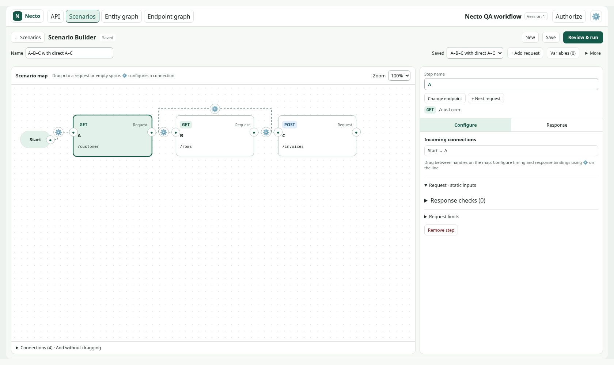

# Scenario connections avoid request cards

A direct A → C line previously passed through B when the map contained A → B → C. Connections now follow orthogonal paths around request cards, with clearance for the line and its configuration button. The button sits halfway along the actual route instead of halfway between endpoint coordinates.

The router uses a shared compressed grid and bounded shortest-path search with a bend penalty. Simple connections take a cheap clear path; longer connections go around obstacles. Card geometry is consistent with routing dimensions. Start, manually positioned requests, reverse-direction paths and zoom use the same coordinate system. Routes are derived UI geometry and are not stored in scenario definitions.

Search has per-edge and per-layout budgets. If overlapping cards obstruct an endpoint, or a route cannot be found within the budget, the map displays a notice and leaves the connection editable in the Connections list. It does not silently draw a line through a request or remove the dependency. Connection-to-connection crossings and overlapping paths are still possible; this change specifically avoids request cards.

Validation includes the A–B–C/A–C case, pinned and reverse positions, vertical stacks, Start, configuration-button clearance, impossible layouts and 100 requests with 1,000 connections. The browser test compares actual rendered card bounds against line segments at 100%/65%, checks popup placement and verifies the list fallback. Existing drag/connection/polling and add-next browser regressions pass.
