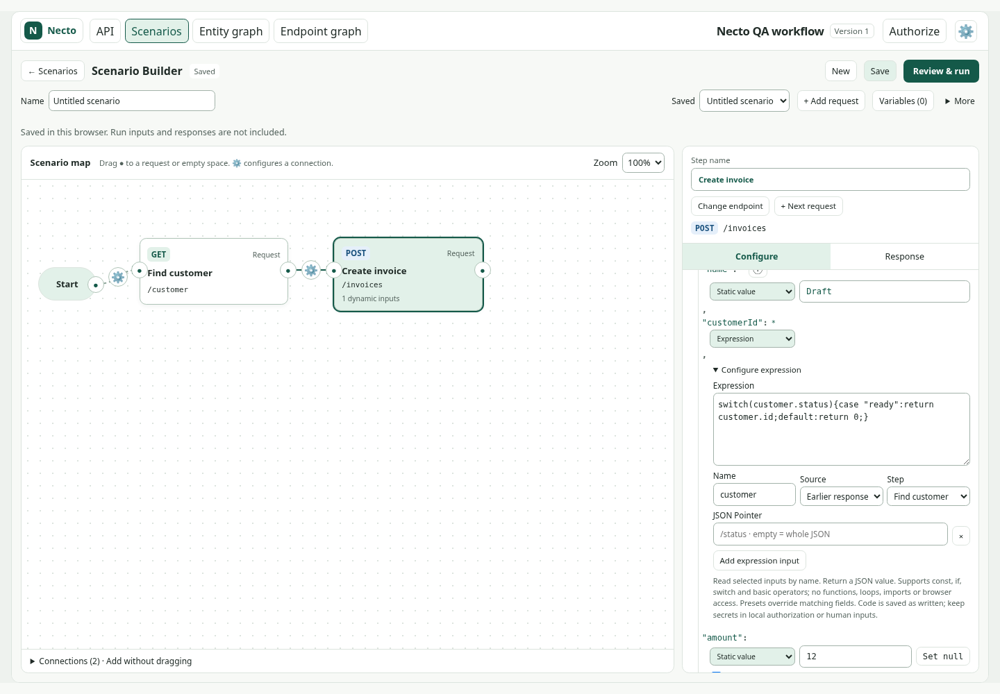

# Isolated scenario expressions

Choose **Expression** as the value source beside a JSON body field or in Dynamic inputs for a path, query or header parameter. Add named inputs from earlier response JSON slices or shared variables, then return the value for the field:

```javascript
switch (invoice.status) {
  case "draft": return "review";
  case "approved": return "send";
  default: return "skip";
}
```

Select the invoice response as input `invoice`. Prefer a narrower JSON Pointer for large responses. Multiple source steps add dependencies automatically: the target waits for all of them. Expressions run once before dispatch; retries reuse the computed value. Run presets override matching fields. Human variables work through the existing human-in-the-loop option.

Errors stop the consumer before its request; already completed requests cannot be undone. Review & run checks syntax and graph dependencies without evaluating code or sending requests. There is no global context or automatic response access. This feature calculates values; it does not skip scenario steps.

Saved Builder definitions use **version 7** (expressions were introduced in version 6). Versions 1–6 remain readable and are upgraded when saved. Older Necto clients reject unsupported format versions rather than silently ignoring expressions. Shared folder import/export and the [authoring skill](../../skills/README.md) support the same format. Code is saved verbatim: keep secrets out of literals. Folder export refuses expressions targeting sensitive fields.



See [the skill expression reference](../../skills/necto-scenarios/references/expressions.md) for exact JSON, syntax and offline testing.

## Security design

- **No host evaluation:** Acorn parses source into AST; an explicit interpreter handles a small syntax whitelist. There is no `eval`, `Function`, iframe execution or native execution of user scripts.
- **No host capabilities:** calls, functions, constructors, imports, loops, assignments, getters/setters, templates, spread, regular expressions, BigInt and async are rejected, including unreachable branches. Browser APIs, network, modules and storage are never placed in scope.
- **Data isolation:** explicit bindings supply detached plain JSON. Prototype keys (`__proto__`, `prototype`, `constructor`), inherited properties, accessors, functions, non-finite numbers and non-JSON host objects are rejected. Own missing properties can be handled with `??`; undefined output is rejected.
- **Bounded work:** source ≤4,096 characters; AST ≤512 nodes; depth ≤32; bindings ≤16; interpreter budget 2,500 instructions; copied data ≤10,000 values; selected inputs ≤1 MiB and result ≤64 KiB using conservative accounting. There are no loops or user calls; numeric/string operators avoid object coercion. No unbounded user-controlled regular expression is executed.
- **Fail closed:** preflight rejects unsupported definitions before any API call. Runtime failures/cancellation prevent the consumer's request and flow through the existing scenario stop behavior. Interpreter errors contain neither source nor input values.

The interpreter runs synchronously with bounded operations; it is not a separate process or a full ECMAScript engine. Syntax additions require a security review and adversarial tests. No claim of an independent security audit is made.

Isolation prevents scripts from accessing the browser. It does not make a scenario harmless: ordinary response bindings and expressions can forward data to configured endpoints. Import never executes the scenario; review endpoint targets and code before running. The interpreter does not classify arbitrary secrets. Code literals and business data need a privacy review before committing to Git; do not grant execution approval based solely on successful structural validation.

## Validation

Interpreter tests cover host escape attempts, unsupported syntax in dead branches, prototype access, getters, data detachment, source/AST/data/result limits, arithmetic failures and payload-free errors. Integration tests cover joins, response variables, human inputs, presets, cancellation, save/import, version gating, sensitive targets and removal/undo. A browser flow covers field editing, persistence and blocking both unsupported syntax and runtime-invalid output.

Scenario-wide authoring limits: at most 100 expressions, 65,536 source characters and 256 selected bindings. These bound preflight work across the whole graph as well as individual evaluations.
