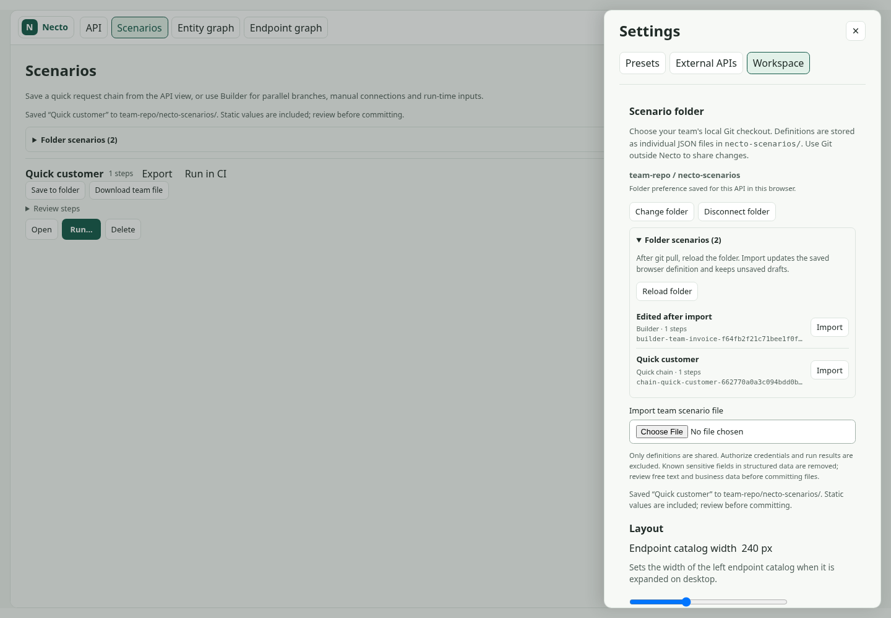

# Team scenario folders

Use a local Git checkout to share quick chains and Scenario Builder definitions. Folder access belongs to the **browser user's computer**, not the ASP.NET server. Necto does not run Git commands or send scenario files to a hosted service.

## Workflow

1. Clone your team's repository locally.
2. In **Settings → Workspace → Scenario folder**, choose that checkout. Necto remembers the directory handle for this API workspace in this browser.
3. In **Scenario Builder → More**, choose **Save to folder**. Quick scenarios have the same action on their cards.
4. Review and commit files under `necto-scenarios/`, then use your normal Git workflow.
5. After a teammate's `git pull`, use **Reload folder** and **Import** on the required file. Open its saved browser definition to edit it.

Import updates saved browser definitions. It keeps any currently unsaved draft and never runs a request. Builder files appear in its **Saved** selector; quick chains appear in **Scenarios**. Browser Save remains a separate action. Local deletion and Disconnect leave the files on disk intact.



## Files and conflicts

- One versioned `*.necto.json` file per definition; quick chains and Builder files are distinguished by `kind`.
- Stable filenames combine a readable name with a hash of the definition ID. Renaming a scenario keeps its existing file; duplicate IDs in a folder are reported.
- File revisions are associated with the definition actually opened for editing. Reloading the listing or importing a newer saved copy does **not** authorize an older unsaved draft to overwrite it.
- A changed file must be reloaded and imported before saving its edited version. Existing files are checked again after opening the write stream; supported browsers request an exclusive stream.
- This is optimistic conflict detection, not an atomic transaction with external Git processes. Avoid checking out or editing the same file while saving it in Necto.
- There is no background sync or automatic file deletion. Only the dedicated `necto-scenarios` subfolder is scanned: at most 100 managed files, 2 MiB per file and 20 MiB per scan. Unrelated files are not imported.

The format wraps the existing definition schema:

```json
{
  "format": "necto-shared-scenario",
  "version": 1,
  "kind": "builder",
  "scenario": { "format": "necto-scenario-builder", "version": 5 }
}
```

The abbreviated `scenario` above must be a complete valid definition in a real file. [A complete quick-chain example](examples/list-invoices.necto.json) works with SampleApi.

## Retained data

Only definition fields are written. Responses, execution state, human answers, Authorize credentials, browser folder handles and uploaded file contents are excluded. Recognized sensitive names and `x-necto-sensitive-properties` metadata are applied to structured static data. A static variable used for a sensitive input becomes a human input in the shared copy. All referenced endpoints must be visible in the catalog before exporting, so their retention metadata is available.

Static payloads, free text, selector values and business data may still be sensitive: review the files before committing them. Removed values may need a local preset, authorization, human input or a reattached file before the scenario can run. Sharing does not modify the original browser draft's private inputs.

## Browser support

Directory selection requires File System Access support in a secure context, such as desktop Chrome/Edge over HTTPS or localhost. Remembered access is restored without displaying a permission prompt; **Reconnect folder** requests permission when needed. If IndexedDB is unavailable, the connection can still work for the current session.

Browsers without directory selection, including common Android configurations, can use **Download team file** and **Settings → Workspace → Import team scenario file**. The JSON format is identical. Each teammate chooses their own checkout; handles and permissions are never shared through Git.

## Validation

- Module coverage for format validation, sensitive data, filenames, limits, permission denial/cancellation, unavailable IndexedDB, workspace changes and write conflicts.
- Chromium coverage uses real directory/file handles in its private filesystem to exercise reads, writes, handle persistence, both scenario kinds, draft provenance and unsupported-browser import/download. It does not automate the OS directory chooser or run Git.
- Existing Builder, shared-variable, preset and sensitive-field browser regressions remain in place.

```sh
npm run build --prefix Necto.UI
PLAYWRIGHT_MODULE=/path/to/playwright node Necto.UI/tests/scenario-folder.e2e.cjs
```

Set `NECTO_FOLDER_SCREENSHOTS` to save a preview.
