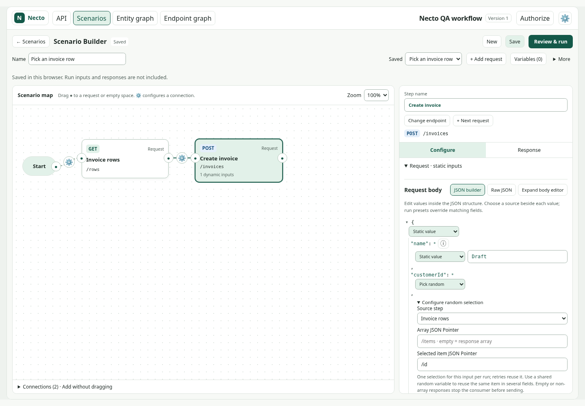

# Pick random

In Scenario Builder, select **Pick random** beside a JSON field or in **Dynamic inputs**. Choose the source step, the JSON Pointer to its array, and the pointer within the selected element:

- `/items` → `/id`: use an ID from a random object in a wrapped list.
- Empty array pointer → `/id`: the response itself is the array.
- Empty item pointer: use the whole selected object or primitive.

The source becomes a graph dependency automatically. Random selection occurs once per input per run, after the source succeeds; polling retries keep the chosen value. A matching run preset overrides it.

For related fields from the **same record**, add a **Shared variable → Pick random** with an empty item pointer, then use the variable in expressions for each field. The variable is chosen once across all parallel consumers. Separate random inputs are independent and may choose different items.

Empty/non-array responses and missing fields stop the consumer before sending its request. Sampling uses browser cryptography and bounded rejection sampling to avoid modulo bias. Randomness stays outside the isolated expression interpreter. Pointer prototype guards remain active; definitions contain only selection configuration, not the selected response values.

Builder format is now **version 7**. Versions 1–6 remain readable; older clients reject an unsupported version. No deterministic seed/replay or uniqueness guarantee is provided. Select an eligible list first: random selection does not infer business eligibility.

The [updated skill reference](../../skills/necto-scenarios/references/random.md) and [complete SampleApi example](../../skills/necto-scenarios/examples/random-invoice.necto.json) are ready for agent authoring/import. Importing never executes the scenario.

