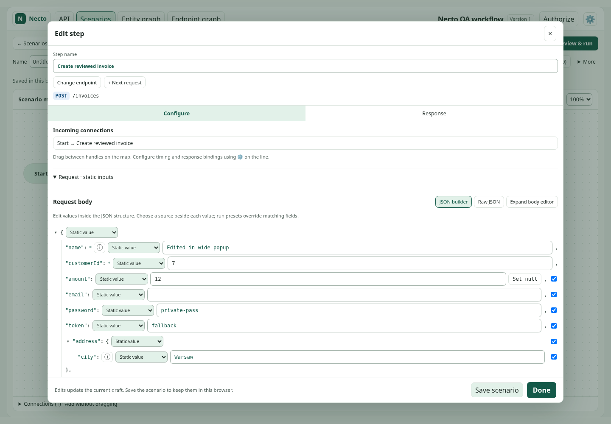

# Scenario step editor

The right-hand inspector was too narrow for nested request bodies and response previews. Clicking a request now opens its configuration or response in a wide modal. The map uses the full workspace width when the editor is closed.

- New requests open the editor after endpoint selection; changing endpoints and adding a successor use the existing nested picker.
- Configure and Response remain together. Existing body sources, limits, checks and response controls are retained.
- Done, Escape and closing the backdrop keep changes in the current draft. Save scenario persists the definition in this browser; closing is not a rollback.
- The title/footer remain visible while the body scrolls. Native dialog focus stays inside the popup and returns to the map opener when closed. The editor fits the mobile viewport.
- During execution, existing read-only restrictions remain active. Nested dialogs close independently.

Browser validation covers form editing/save, draft retention, keyboard focus, nested endpoint/body dialogs, adding a successor, responses and mobile overflow. Number editing, step removal/undo and response checks have dedicated regressions for the modal flow.
