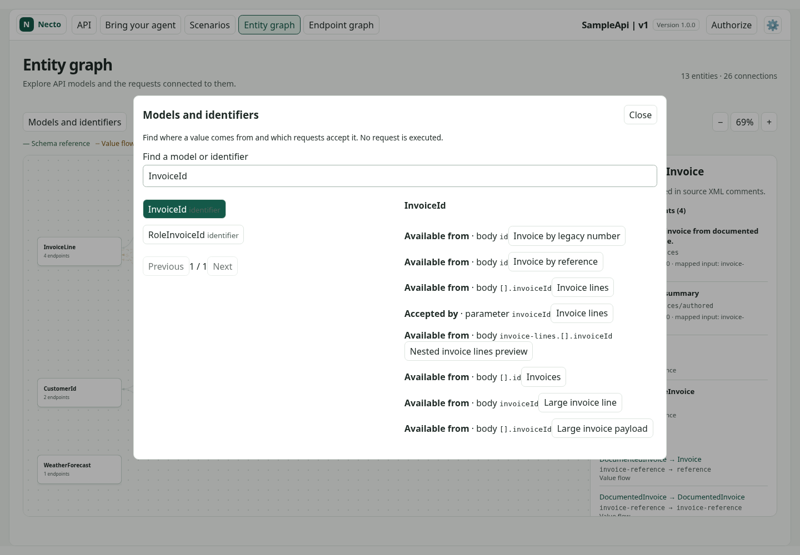
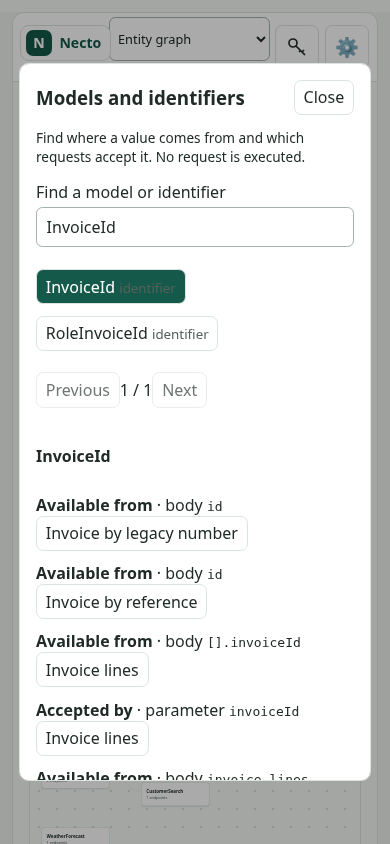

# Generated models and identifiers

Register `app.MapNectoEntityCatalog()` alongside the mappings route. Necto UI discovers the route, including PathBase. Apply the same authorization policy to this returned builder as to the UI/mappings; the endpoint is opt-in and does not inherit policy from other routes.

Entity graph → **Models and identifiers** opens a searchable, paged catalog. Select an identifier to see **Available from** producers and **Accepted by** request inputs, including nested JSON paths and array items. Opening an operation fills no values and sends nothing. Hidden/unavailable or ambiguous operations are not linked.

The source generator uses JSON-visible properties, CLR qualification and existing identifier conventions/EndpointValue keys. It does not infer business workflows. DTOs hidden behind opaque return types/custom converters and nested request structures outside the existing mapping reader remain outside the catalog. Data values and credentials are never emitted. Separate imported API workspaces do not retain the host catalog URL.

Validation: 32 .NET Release tests, UI/module coverage for scoped navigation, pagination and malformed metadata; Chromium verified a real generated InvoiceId with producers and consumers.

Screenshots come from local combined validation of the six generator PRs. Combined checks: 38 .NET integration tests, 8 Roslyn tests, 189 UI/module tests and desktop/mobile browser flows. No production APIs were called.
