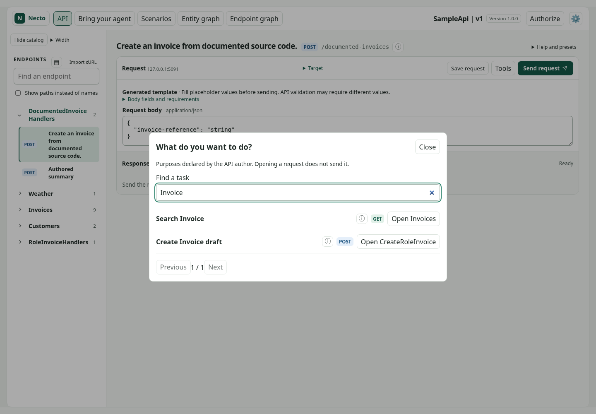

# Author-declared operation purposes

Annotate a directly referenced handler or lambda:

```csharp
[NectoOperation(typeof(Invoice), NectoOperationRole.Create,
    Description = "Create a draft after reviewing the customer and amounts.")]
static Invoice CreateInvoice([FromBody] Invoice request) => request;
```

Roles are Search, Read, Create, Update, Delete and Action. `EntityName` optionally overrides the display name; the qualified entity ID remains separate. Multiple roles/entities can be declared explicitly. No role is guessed from HTTP verbs, names or identifier matches.

Register `app.MapNectoOperationRoles()` and apply the host authorization policy to its returned builder. Necto discovers one static registered route, respecting PathBase. Metadata contains purposes, not credentials or business data. This route is opt-in and does not inherit authorization from other routes.

The compact **Find by task** button in the endpoint catalog opens a searchable, paged dialog. Selecting a task opens its current visible request for review; it never sends a request. Hidden or ambiguous operations are omitted. Descriptions remain behind an information button. Imported unrelated workspaces drop host role URLs; metadata loads use scoped authentication and bounded reads.

Validation: 32 .NET Release tests cover declared lambda/method roles, omission of unannotated operations and route discovery; 186 UI/module tests cover scoping, ambiguity, pagination and validation. Chromium verified that a Create task opens the POST editor with zero writes.


