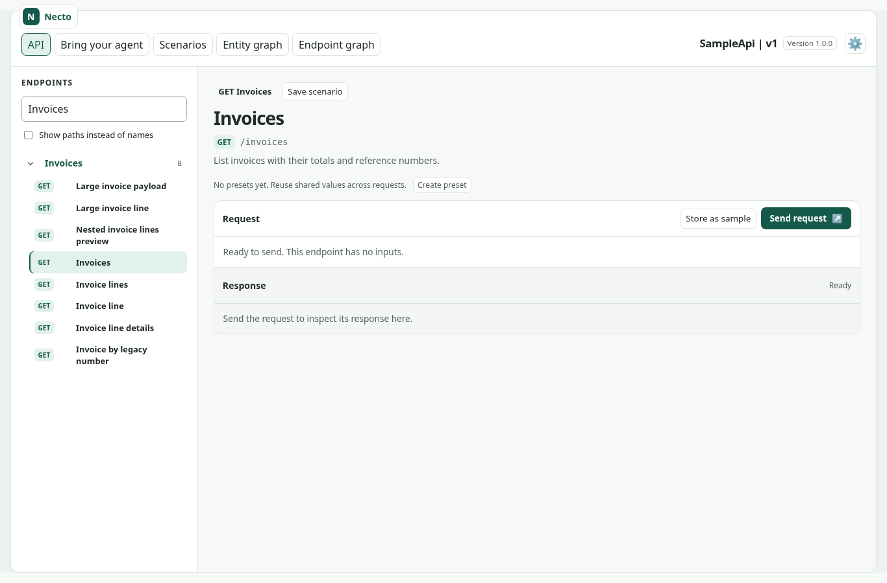
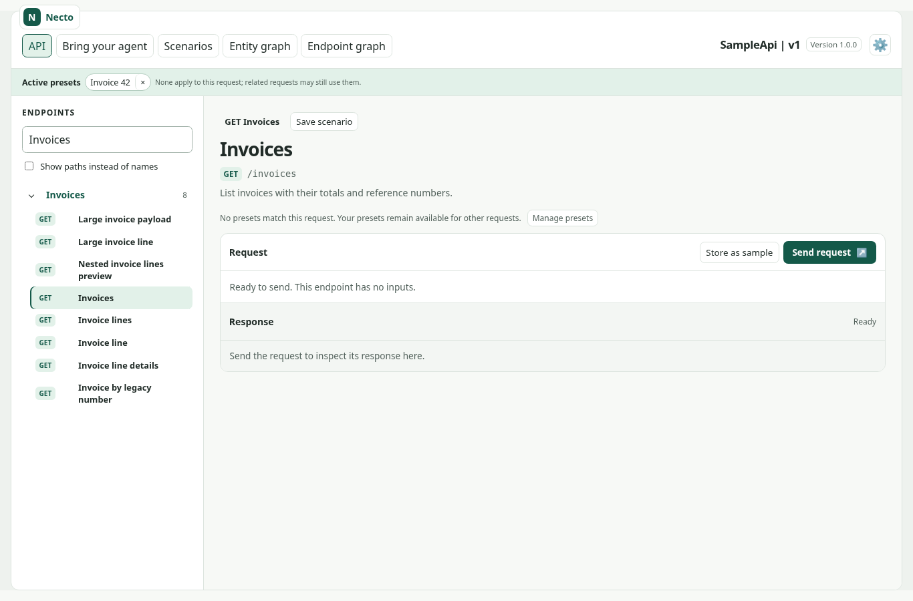

# P3: jednoznaczne puste stany presetów

Problem: dawny komunikat „No matching presets” nie rozróżniał pierwszego uruchomienia od istniejących presetów niepasujących do danego requestu. Po schowaniu pustej kolumny presetów brakowało też bezpośredniej drogi do utworzenia pierwszego presetu.

Poprawka: kompaktowa informacja i akcja „Create preset” przy pierwszym użyciu, „Manage presets” przy braku dopasowań oraz „Manage connection”, gdy presety są wyłączone dla zewnętrznego API. Settings wyjaśnia zastosowanie presetów i sposób rozpoczęcia. Aktywne presety nadal są widoczne w dotychczasowym pasku; nie wraca pusta boczna kolumna.

Weryfikacja: build UI; Chromium: utworzenie presetu i wartości, aktywacja i wypełnienie pola, brak dopasowania przy innym endpoincie z zachowaniem aktywnego presetu, właściwa sekcja Settings dla każdej akcji, wyłączone presety w zewnętrznym API, szerokość 390 px, brak błędów JavaScript.

