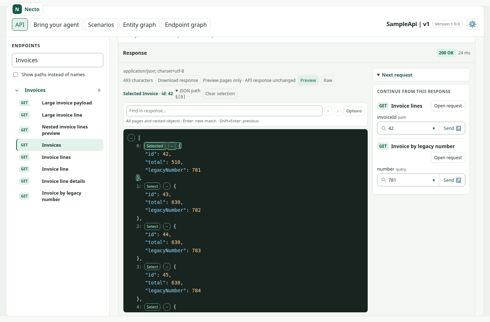

# P3: zaznaczenie obiektu zamiast samego indeksu

Problem: „Selected: [0]” pokazywało miejsce w JSON, ale nie mówiło, który obiekt został wybrany i jakie dane będą podstawą kolejnego requestu.

Poprawka: podgląd pokazuje typ z tytułu lub referencji schematu OpenAPI oraz maksymalnie dwa rzeczywiste pola identyfikujące, np. „Selected Invoice · id: 42”. Gdy typ nie jest jednoznaczny, używa neutralnego „object”. Dokładna ścieżka JSON pozostaje dostępna w rozwijanym szczególe. Opis nie zmienia zaznaczenia ani mapowania wartości. Przetwarzana jest tylko zaznaczona ścieżka i ograniczona liczba pól, bez skanowania całego payloadu.

Weryfikacja: 80 testów UI, w tym pięć nowych testów opisów zaznaczenia (tablice, zagnieżdżenia, schematy złożone, brak/niejednoznaczny typ, status HTTP/media type, ograniczenie długości i cykle); build UI; Chromium: wybór faktury 42 i 45, ścieżka JSON, czyszczenie, przekazanie ID 45 do powiązanego requestu, zaznaczenie linii, szerokość 390 px, brak błędów JavaScript.

