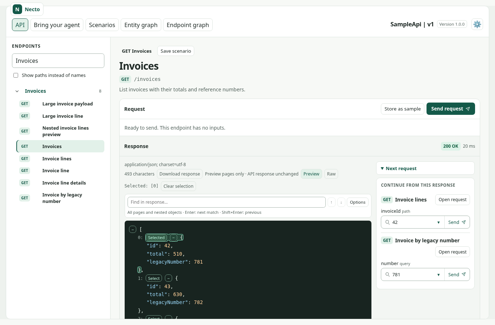

# P3: wysłanie requestu nie wygląda jak otwarcie zewnętrznej strony

Problem: strzałka ↗ przy „Send request” i „Send” kojarzyła się z otwarciem nowej karty lub przejściem poza aplikację, chociaż akcja wykonuje request w Necto.

Poprawka: jedna ikona wysyłania (papierowy samolot) w formularzu i obu wariantach powiązanej akcji Send. Wewnętrzne „Open request” z grafu także nie udaje linku zewnętrznego. Tekst przycisku pozostaje widoczny, a dekoracyjna ikona nie zmienia jego nazwy dla czytników ekranu. Skrót Ctrl/⌘ + Enter pozostaje dostępny.

Weryfikacja: build UI; Chromium: wysłanie głównego requestu przyciskiem i Ctrl+Enter, powiązane Send z polem i z wartością z presetu, otwarcie formularza z grafu bez dodatkowego requestu, brak nowych kart, szerokość 390 px; brak błędów JavaScript.

