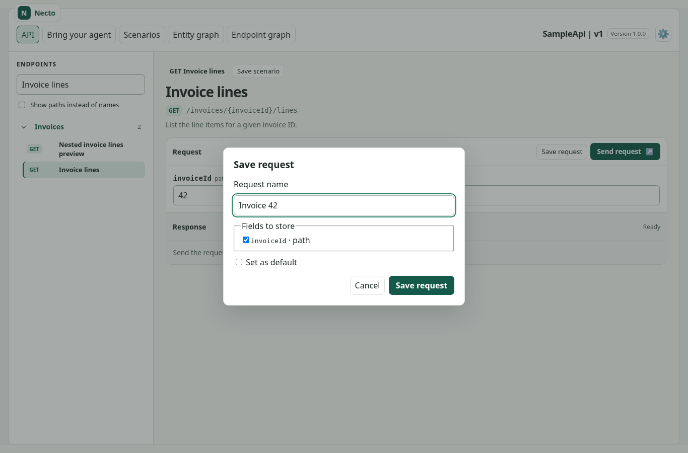

# P3: spójne nazwy zapisanych requestów

Problem: przycisk „Store as sample”, lista „Saved requests”, pole „Sample name” i akcja „Save sample” nazywały tę samą funkcję różnymi słowami.

Poprawka: konsekwentne „Save request”, „Saved requests” i „Request name”, również w komunikatach błędów i etykietach dostępności. Wewnętrzny format danych i klucze localStorage pozostają zgodne z istniejącymi zapisami.

Weryfikacja: build UI; w Chromium zapis, wczytanie wartości, konflikt nazwy, zmiana nazwy i zachowanie danych po odświeżeniu. Brak błędów JavaScript.

