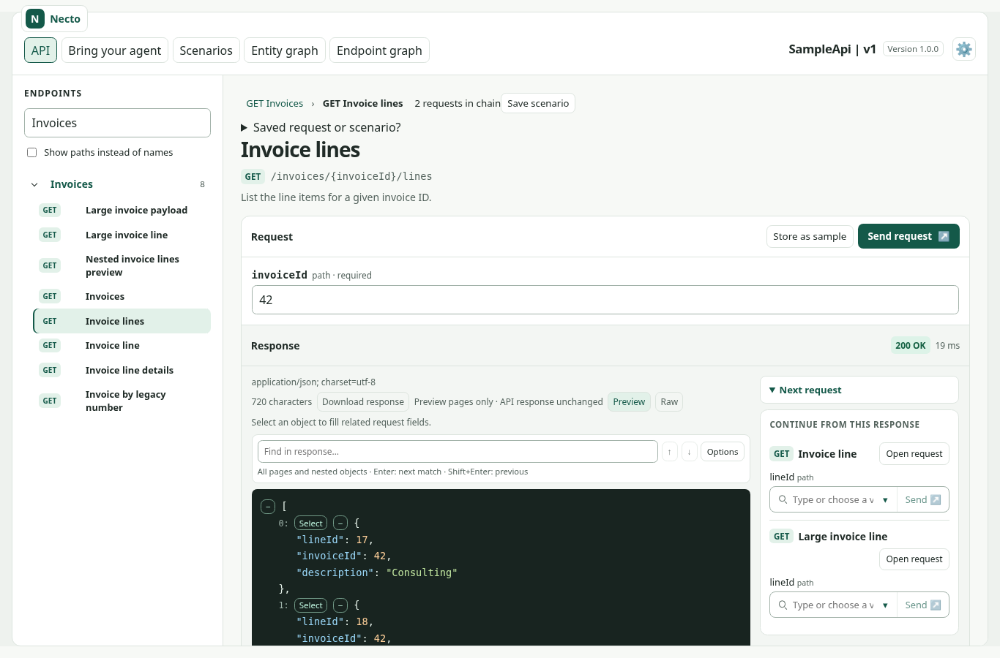

# P3: co zapisuje request, a co scenariusz

Problem: „Save scenario” pojawiało się już dla pojedynczego, niewysłanego requestu, bez wyjaśnienia różnicy między scenariuszem a zapisanymi danymi endpointu.

Poprawka: przy akcji zapisu widać liczbę requestów w łańcuchu. Rozwijane objaśnienie porównuje Saved requests, Scenarios i Presets. Dialog scenariusza podaje, ile requestów zapisze i do czego służy taki zapis. Pojedynczy krok pozostaje poprawnym scenariuszem.

Weryfikacja: build UI; Chromium: zapis scenariusza z jednym i dwoma krokami, aktualizacja licznika po powiązanym requeście, obecność zapisu na liście scenariuszy, układ przy szerokości 390 px; brak błędów JavaScript.

