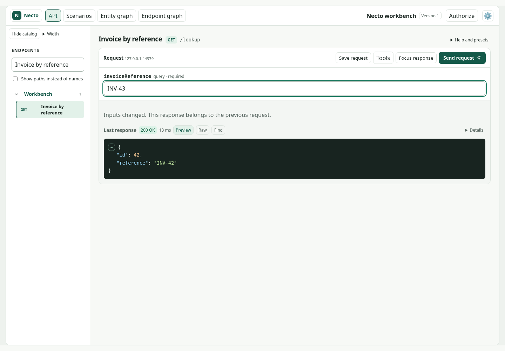

# U01 — Response belongs to a sent request

Changing effective inputs previously left a green response with no indication that it belonged to an older request. Responses now retain an in-memory, masked snapshot and an input identity. Parameter/body/preset/server/upload changes expose the existing compact stale notice; failed attempts retain a clearly labeled previous response. Code export can explicitly choose the sent request or current draft. Uploaded bytes are excluded from snapshots.

Validation: UI production build, 119 unit tests; browser invoice lookup INV-42 → edit INV-43 → stale notice → copy sent/draft → resend clears notice.

