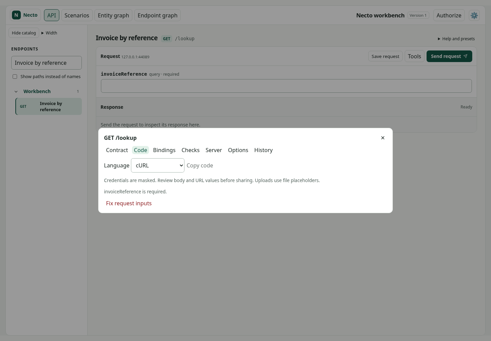

# U02 — Code export has an explicit error state

A missing parameter used to appear inside the code block while Copy code remained enabled. Preparation failures now appear as alerts, copying is disabled and Fix request inputs closes the dialog and focuses the request editor. Editing inputs or changing language resets clipboard feedback.

Validation: production build; browser verifies disabled copying for a missing invoiceReference, focus back to the editor and enabled copying after fixing the input.

