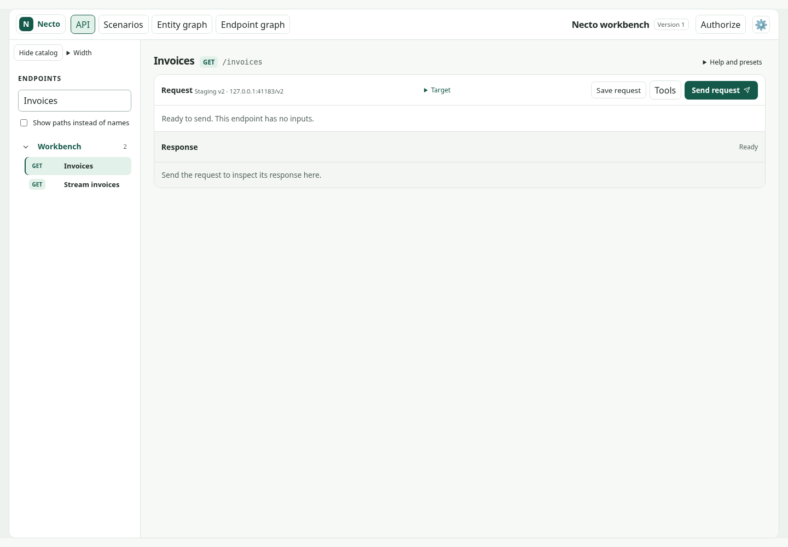

# U03 — Recognizable effective target

Host-only context hid the difference between /v1 and /v2 on the same API. The existing Request heading now includes the selected server description and base path. Target opens a compact popover with the API identity, target source and masked full URL, while remaining useful for incomplete inputs. Credential-origin approval remains explicit.

Validation: target resolution unit test, production build; browser same-host server selection and 390 px layout.

