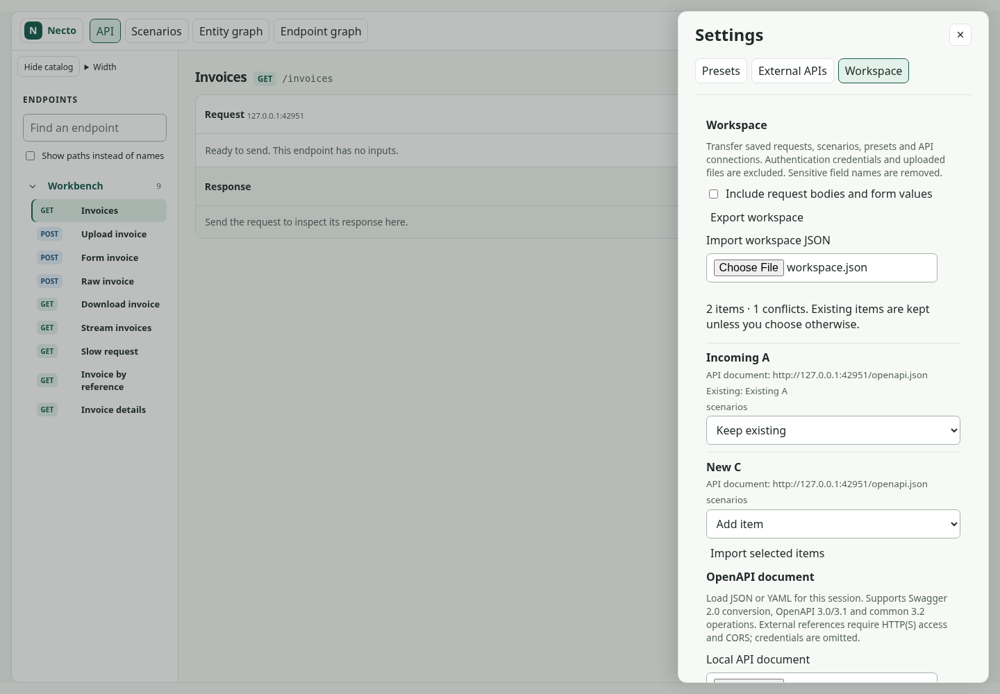

# U04 — Transfer named items, not storage collections

Import now previews named scenarios, requests, presets, API connections and server profiles. Conflicts default to keeping the existing item. Replacing affects only that item; scenarios/requests/presets can also be imported as copies. Both current request-samples keys and legacy samples keys are supported. Unrelated items, active settings and local credentials survive the merge, with transactional rollback if a write fails. API connection identities are never silently remapped.

Scenarios have their own Export action and a body-inclusion choice. Export remains versioned and excludes auth sessions/upload bytes. Imported settings retain their API-document scope and require reload to activate, as before.

Validation: production build, 122 unit tests including merge/copy/export/rollback and preservation of unrelated credentials; browser keeps scenarios A/B while adding C and downloads a single-scenario file.

