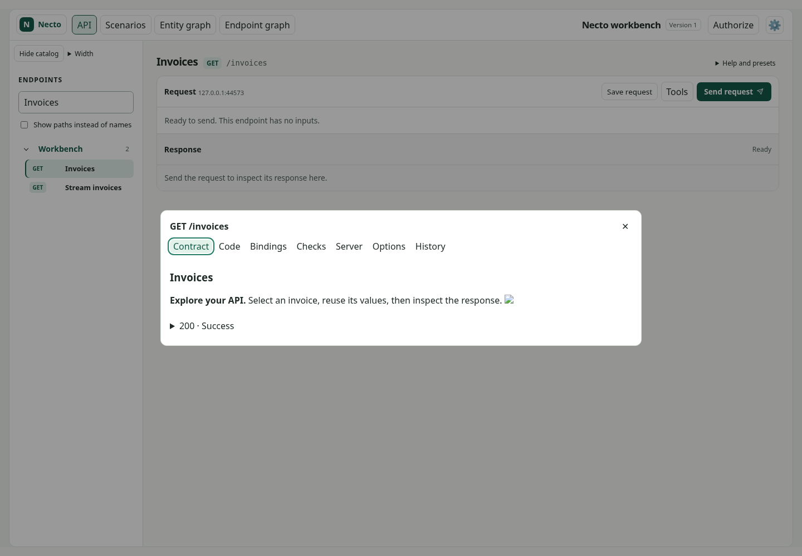

# U05 — Named, keyboard-accessible request tools

Tools lacked an accessible dialog name and exposed its seven sections only as unrelated buttons. The dialog now names its method/path, connects the trigger with the dialog and restores focus when closed. Sections use an ARIA tablist, roving tab stops, labeled panels and ArrowLeft/ArrowRight/Home/End navigation. Layout and response space are unchanged.

Validation: production build; browser accessible-name lookup, arrow/home navigation, selected panel and Escape focus restoration. Existing workbench browser fixture updated for tab semantics.

