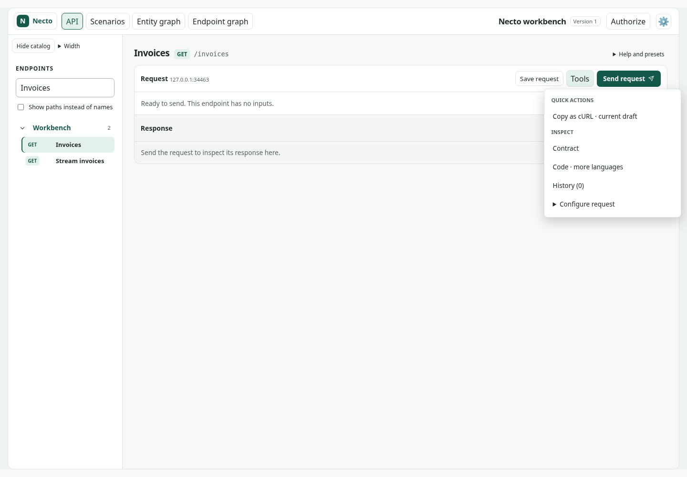

# U06 — Quick actions before advanced tools

Tools previously opened seven equally weighted sections. It now opens a small menu: copy the current draft as cURL, inspect Contract/Code/History, or expand Configure for checks, server and timeout. Bindings appear only when present, and counts explain the current context. The existing advanced views remain available on demand; there is no new permanent sidebar or toolbar button.

Validation: production build; browser menu grouping, contextual Bindings, advanced dialog, Escape and 390 px overflow check. Invalid inputs disable quick-copy; no request executes from the menu.

