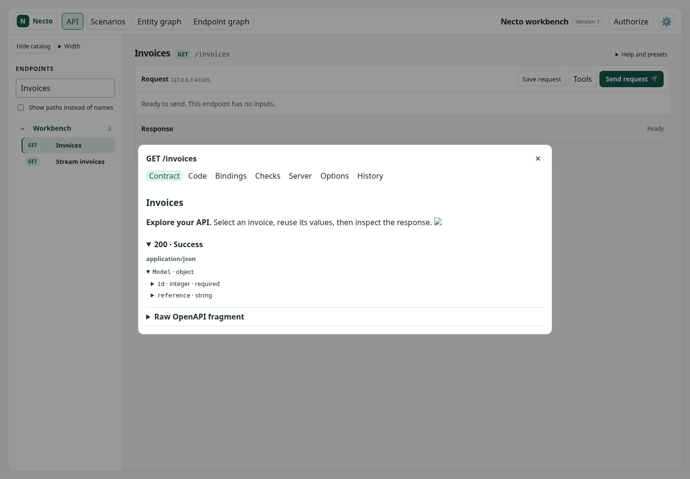

# U07 — Read the contract before its source

Contract now opens the primary response model, presents parameters as labeled fields and separates named examples from models. Raw OpenAPI is a deliberate expansion instead of a duplicate block beneath every response. Request/response media types, requirements and response headers remain available. Union types use readable separators.

Validation: production build; browser default model visibility, no visible raw block and explicit Raw OpenAPI expansion.

