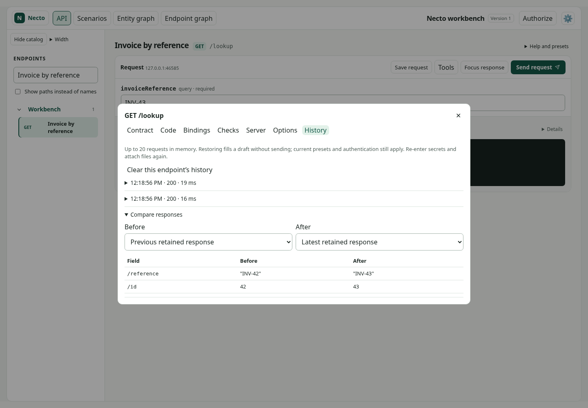

# U08 — History returns to a usable draft

History now offers Restore draft inputs without sending and masked copies of the sent request. Entries use readable local times and comparisons let the user choose Before/After records, showing field/before/after rows rather than a JSON diff dump. Clear affects the current endpoint only.

Snapshots obey the existing per-entry and total memory limits, exclude uploaded bytes and omit secret fields from restored inputs. Current presets/authentication apply on the next send; secrets and files must be supplied again. Oversized entries cannot be restored.

Validation: production build; 118 unit tests including snapshot redaction, upload placeholders and draft restoration; browser INV-42/INV-43 comparison and restoring INV-42 while preserving the INV-43 response without sending.

