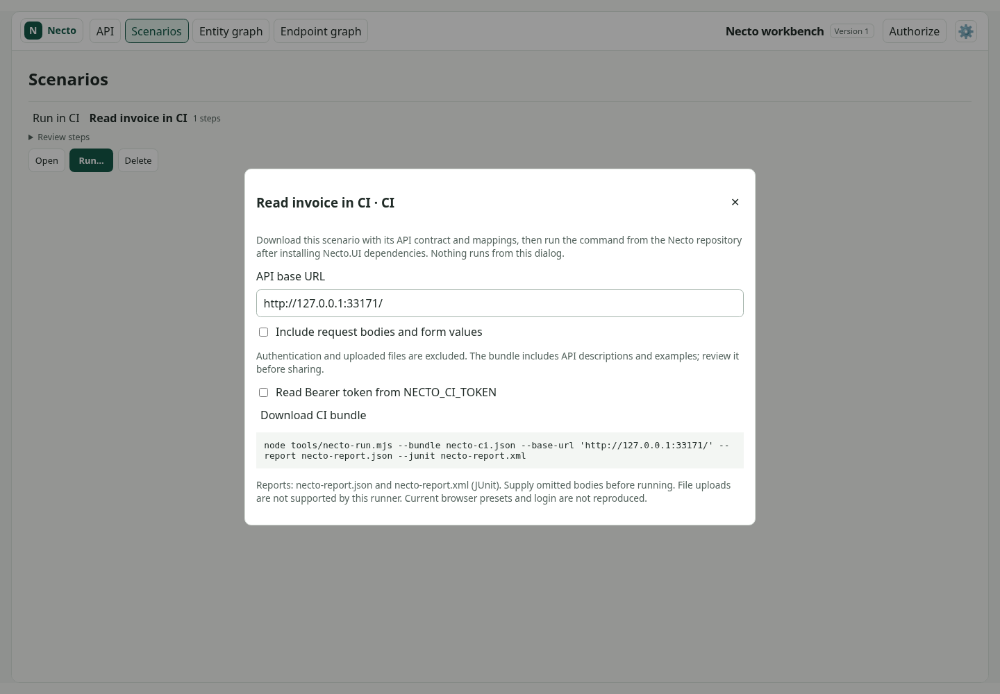

# U09 — Scenario to CI without rebuilding the inputs

Run in CI sits beside a saved scenario. It downloads one versioned bundle containing the masked scenario, current API contract and mappings, and supplies a command with explicit base URL, optional environment-sourced Bearer token and write opt-in. The CLI accepts --bundle and --junit alongside its existing file inputs/JSON report. JUnit escapes names and reports failed/skipped steps.

The current runner supports one local, file-free API scenario. The dialog makes cross-API/file limitations explicit and never executes requests. Request bodies remain opt-in, and API descriptions/examples should be reviewed before sharing. Already bundled references survive loading.

Validation: production build, 119 unit tests including a real child-process CLI run that writes JSON/JUnit; browser scenario → instructions → bundle download.

