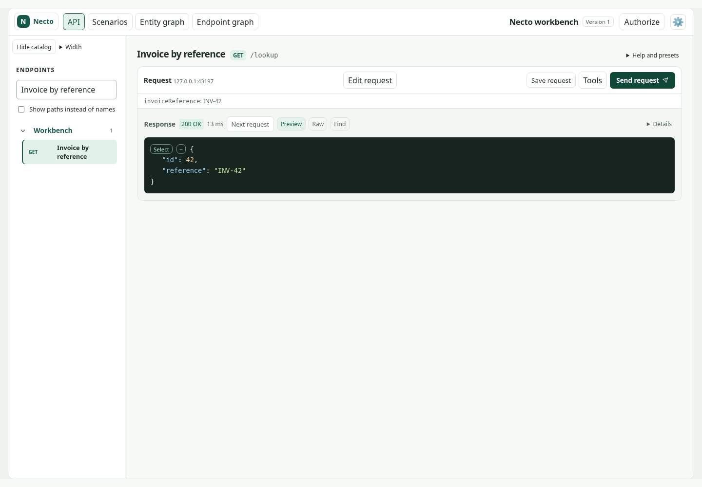

# U10 — Next request shares the response toolbar

A standalone Next request button previously consumed its own row above Response. It now occupies the existing response toolbar. Pinning still moves the related requests beside the response on wide screens, and Unpin returns the trigger to the toolbar. Changing endpoints resets the pinned view.

Validation: production build; browser toolbar placement and pin → unpin cycle. No extra permanent panel is added.

