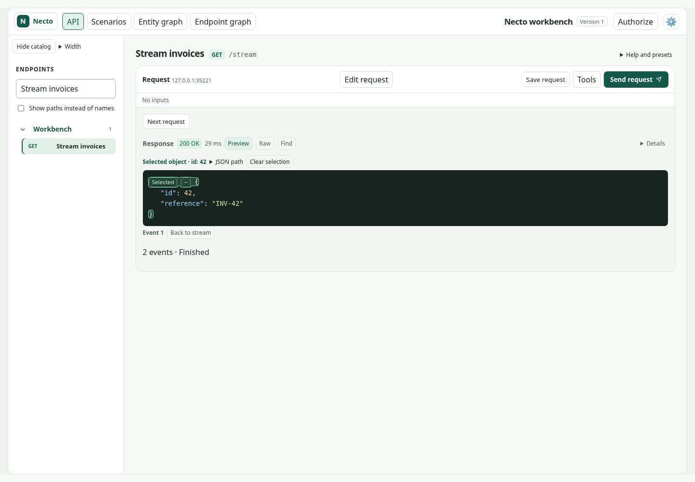

# U11 — Stream events participate in the value flow

Inspect event opens that event in the normal JSON preview, including search and mapped-object selection. Selected fields become available to related requests. Event/path selection survives later stream snapshots. Back to stream restores the bounded event list; cancellation/timeout marks a partial stream as interrupted. Downloads still use retained stream data, not just the inspected event.

Validation: production build, 117 unit tests including progressive snapshot selection; browser NDJSON → inspect event → select object → related value 42 → back to stream.

