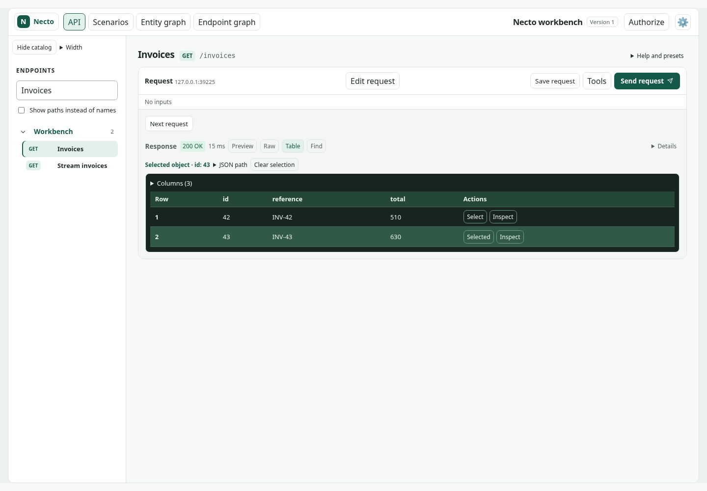

# U12 — Optional collection table

Homogeneous object collections can switch from JSON Preview to Table. Column discovery samples at most 25 rows and exposes at most 12 scalar columns, with six shown by default. Rendering stays paginated at 25 rows and fits the available preview height. Row selection uses the existing mapping paths; Inspect returns to that row in the full JSON tree, including nested fields. Mixed/scalar collections keep the normal preview.

Validation: production build, 117 unit tests including bounded discovery/cells; browser table selection → related value 43 → Inspect → full response. JSON remains the default.

