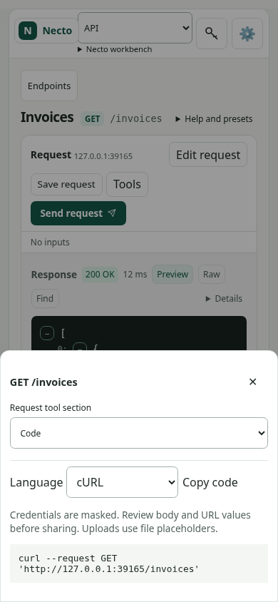

# U13 — Mobile tools as one contextual sheet

On narrow screens Tools is a bottom sheet with a sticky endpoint heading and one native section selector instead of seven wrapping buttons. Controls have 44 px minimum targets, the sheet respects the safe area/viewport height and background scrolling is blocked only while it is open. Changing endpoints closes the sheet. Desktop layout is unchanged.

Validation: production build; 390 px browser section selection, no horizontal overflow, Escape and unchanged response after closing. The existing browser fixture selects mobile sections through the new control.

