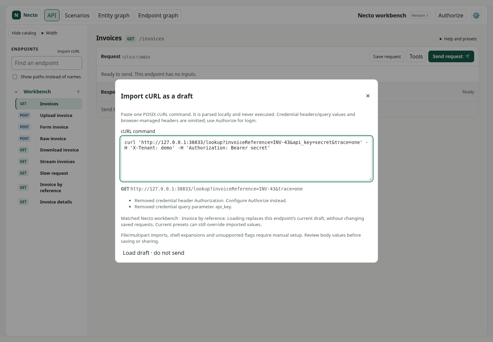

# U14 — Import cURL into a reviewed draft

Import cURL lives in the existing endpoint-catalog heading. It parses a single POSIX command locally, matches the URL/method to a loaded API, previews the destination and requires Load draft. It never executes shell code or sends a request. Credential headers/query values and browser-managed headers are omitted with explanations; use Authorize for login.

Supported inputs include common request/header/URL/data/JSON flags, query-only -G data, path values and repeated query arrays. Undeclared header/query inputs remain visible/editable and survive saved-request/scenario snapshots. Current presets may override imported headers. Ambiguous API matches require a choice. Multipart/file reads, shell expansions, unknown flags and unsupported browser method/body combinations fail explicitly. Input is limited to 1 MB and saved extra-input limits are validated.

Validation: production build, 121 unit tests including quoting, rejected shell/file options, credential removal, API matching and body formats; browser confirms zero API calls on Load draft, then sends the expected reference/header/query only after Send.

