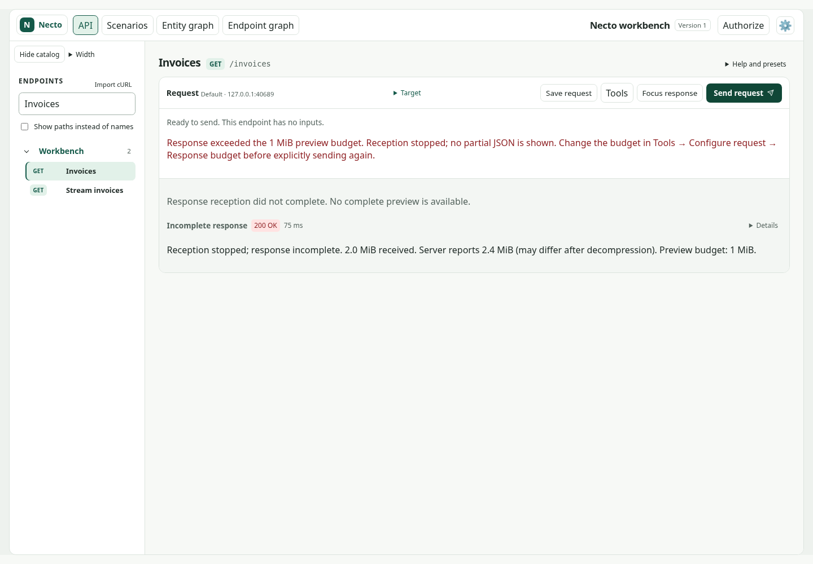

# N01 — Bound response reception before parsing

Ordinary JSON/text responses previously accumulated without a byte budget. A 32 MiB default now counts actual streamed bytes (also without Content-Length), reports progress and cancels reception before parsing an over-budget response. Per-request Tools options allow 1–512 MiB; limits do not silently truncate JSON or retry requests. Incomplete responses cannot be downloaded as originals. Existing binary and bounded SSE/NDJSON paths remain separate.

Validation: 141 UI tests, production build, browser budget rejection with 50,000 rows and disabled incomplete download. Synthetic 10/100/300 MiB reception measurements are recorded in budget-benchmark.json; these validate bounded ingestion, not browser parsing throughput or an end-to-end hundreds-of-MB memory guarantee. UTF-8 chunk boundaries, absent/misleading Content-Length and cancellation while waiting for bytes are covered.

