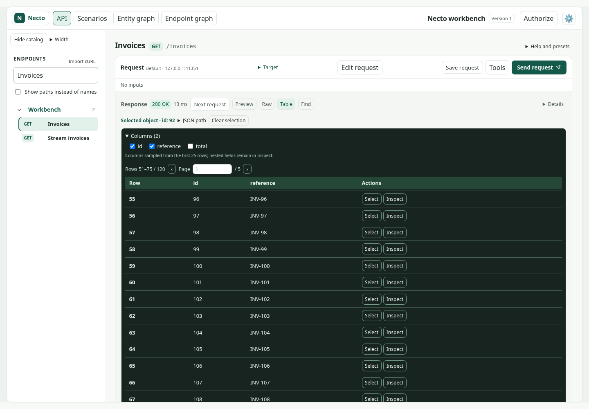

# N02 — Return from Inspect to the same table

Inspect previously returned to the JSON tree and remounted the table, losing pagination and column preferences. Keep the originating table mounted while showing row details and provide Back to table. Its page, columns, scroll and mapped selection survive; a new response still resets the view.

Validation: production build, collection/preview tests and browser assertions on a 120-row response: page 3, hidden total column, scroll offset and selected row preserved after inspecting row 60.

