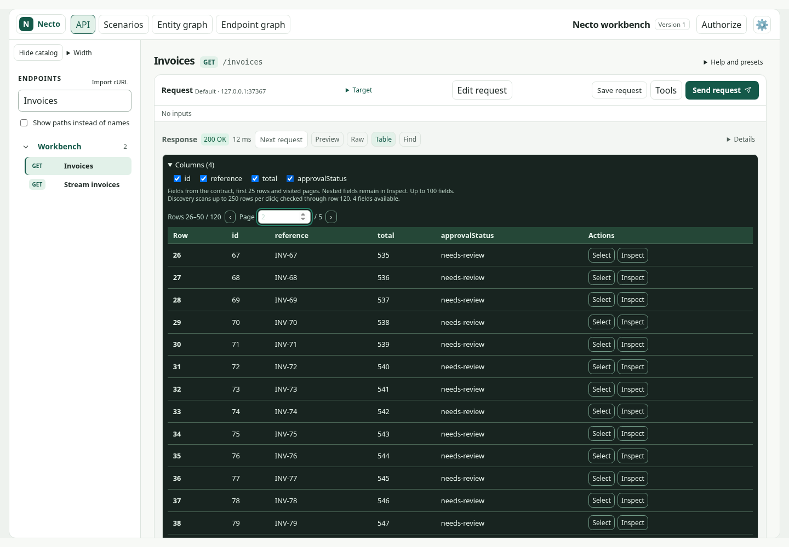

# N03 — Discover fields beyond the first table page

Columns no longer rely solely on the first 25 rows. Scalar fields from the actual response contract are offered initially; visiting pages discovers their fields. Discover more fields checks at most 250 additional rows per click, yielding first, with a 100-field cap. New fields do not silently alter the selected columns, and no full-response scan runs during rendering.

Validation: bounded-discovery/contract tests, production build, and browser flow finding approvalStatus only present from row 26 and showing it on page 2 of a 120-row collection.

