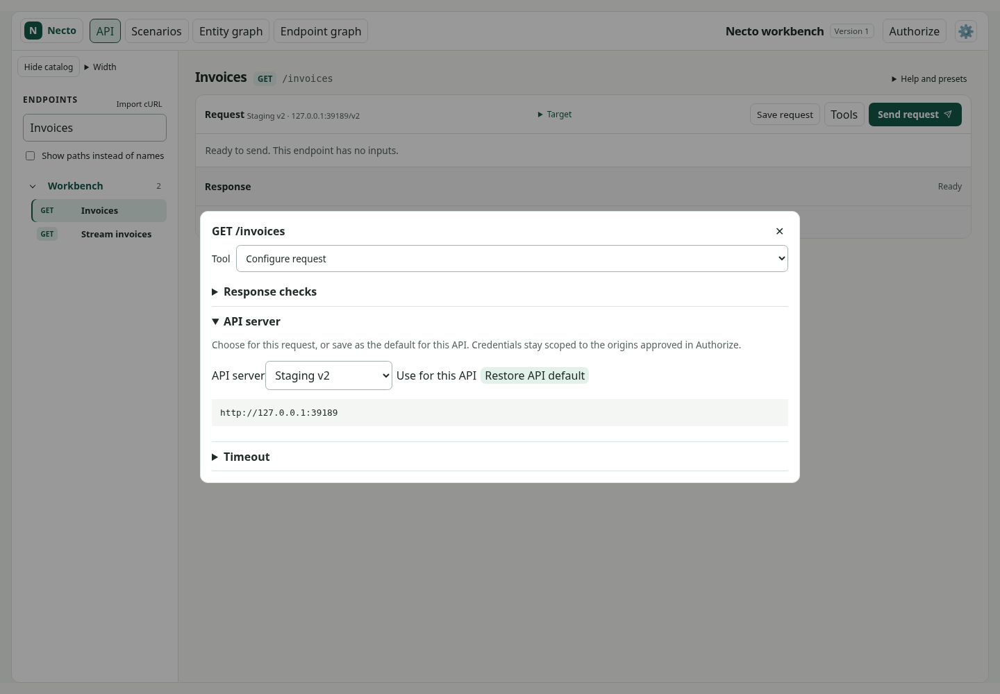

# N04 — One task at a time in request tools

The second Tools level no longer repeats seven tabs. An accessible task picker offers Contract, Code, History and Configure request, with Bindings only when bindings exist. Configure groups checks, server and timeout into collapsible sections. The quick menu also exposes one configuration entry. Dialog naming, Escape and focus restoration remain intact.

Validation: production build and desktop/mobile browser flow verifying four tasks without empty Bindings, server selection, Escape and no page overflow at 390 px.

