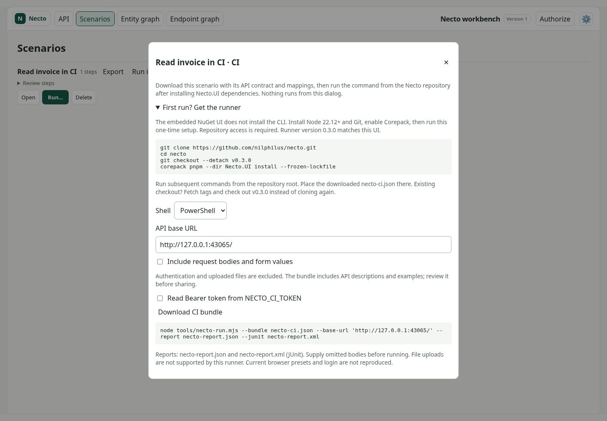

# N05 — Explain how to obtain the scenario runner

Run in CI previously assumed that an embedded NuGet UI user already had tools/necto-run.mjs. A collapsed first-run guide now explains Node/Git/Corepack requirements, checkout and dependency installation, with the runner tag derived from the .NET package version at UI build time. A shell selector generates correctly quoted Bash/zsh or PowerShell targets. Existing bundle and JSON/JUnit behavior is retained.

This PR implements onboarding; it does not claim a separately published CLI package. A standalone distribution remains a later delivery step.

Validation: four CI bundle tests including child-process execution and shell quoting; production build; browser guide/version check and bundle download.

