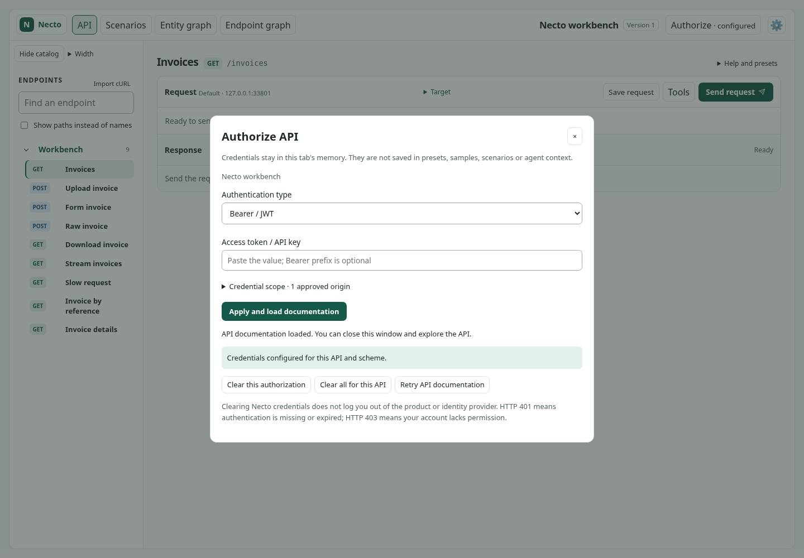

# N06 — Unlock documentation as one guided task

A locked API now opens Unlock API documentation, hides the API selector for one connection and uses the sole declared scheme when available. Credential origins and custom scheme overrides move into a scoped details section without expanding permissions. Apply (or successful SSO) reloads only the selected API's documentation and reports success/failure in the dialog; failed access stays editable. Credentials remain in tab memory.

Validation: 14 authentication tests, production build and a browser test against a protected OpenAPI document (401 → token → automatic reload → catalog), including a storage check that the token is not persisted. Existing real-provider SSO compatibility is not newly certified by this UX change.

