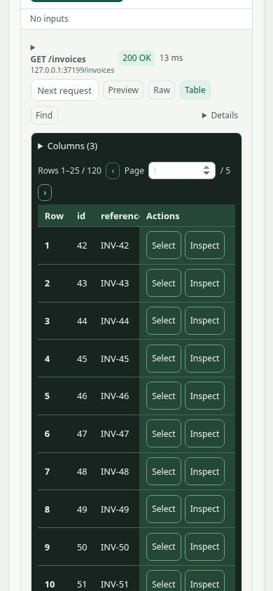

# N07 — Keep mobile response context and row actions in reach

Focus response no longer leaves mobile users with only a generic Response heading. The existing toolbar shows a compact endpoint/target summary, with details on demand. Its target comes from the masked sent-request snapshot rather than edited draft settings. On narrow screens the table action column stays at the right edge, so Inspect does not require horizontal hunting; touch targets are larger.

Validation: production build and browser checks at 390 × 844 for endpoint/target visibility after focus, Inspect inside the viewport without horizontal scrolling, successful row inspection and no page overflow. No new permanent toolbar row or desktop panel.

