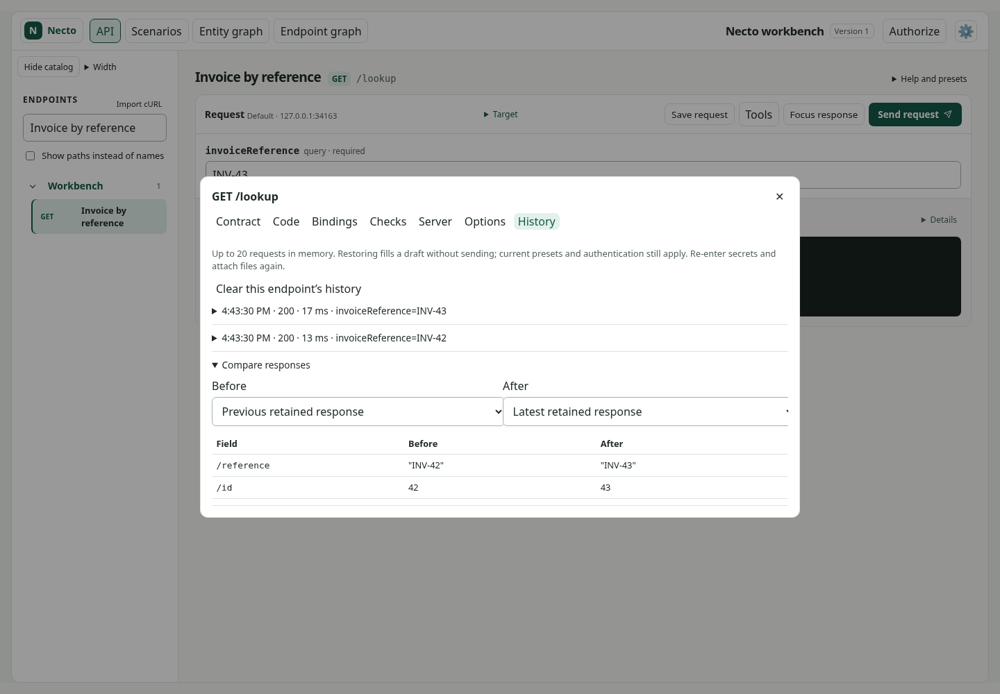

# N08 — Distinguish collapsed history entries by sent inputs

History summaries now include one bounded nonsecret query/path value from the actual sent URL, rather than mutable draft inputs. When the same endpoint was called against multiple targets, the host/base path also appears. Existing collapsed rows and comparison options are reused; no permanent panel is added.

Validation: summary/snapshot tests cover preset overrides, masked secret queries, sensitive path names, malformed URLs and long values; production build; browser flow distinguishes INV-42 and INV-43 without expanding entries.

