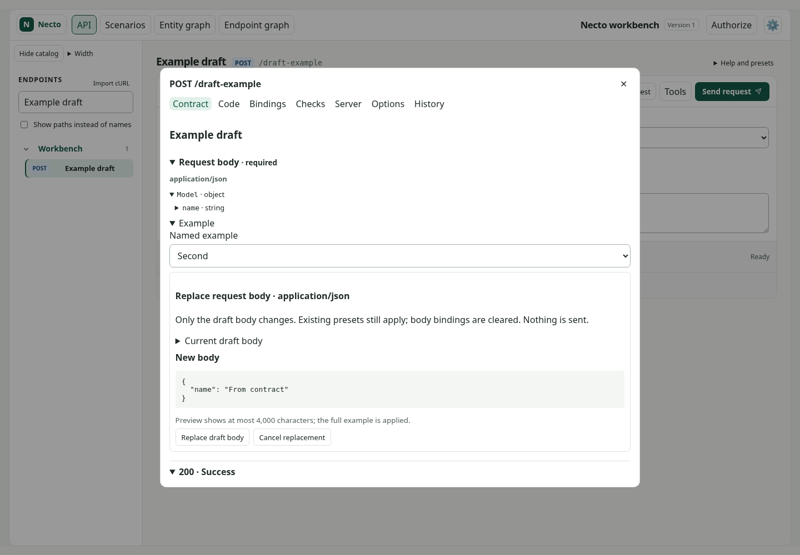

# N09 — Use a request example as a reviewed draft

Contract request-body examples now offer Use as draft, with a bounded preview of the current/new body and explicit Replace/Cancel actions. Applying replaces only the draft body/media type, clears obsolete body bindings and saved-sample labels, keeps the previous response as stale and opens the editor. Existing presets are explicitly called out. Response examples remain read-only; files/forms use their dedicated editors. No request is sent automatically.

Validation: serialization/application tests (including JSON scalars, XML, unsupported media, pending requests and stale response retention), production build, 140 UI tests and a browser flow checking named-example selection, Cancel, replacement and zero automatic POSTs.

